**Procedural Generation and Simulation**  

Prof. Dr. Lena Gieseke \| l.gieseke@filmuniversitaet.de  

---

# Session 05

## Final Project - 80 Points

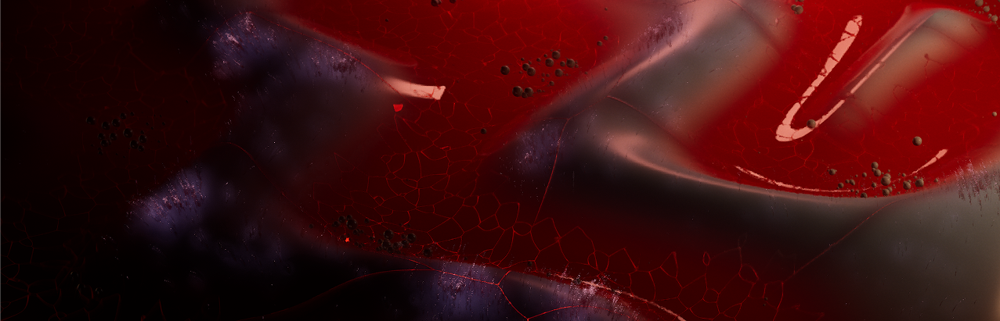

# $Specimen$ $05$

## Summary 
#### [>> Link to the final Demo Video (っᵔ◡ᵔ)っ](https://owncloud.gwdg.de/index.php/s/cEn2Tans2hgCURr) 

*Specimen 05* is a real-time, audio-reactive scene in Unreal Engine 5 that depicts an abstract organism. Its skin is shaped by mathematical functions and traversed by a Voronoi-based vein network, and the music acts as its heartbeat. Each kick sends a pulse of light through the veins and pushes the pearls in the valleys, while high frequencies make the hairs on the hills rise, glow and release a few spores.

TouchDesigner analyses the audio in real time and transmits the resulting values to Unreal Engine via OSC. There, they drive both the materials and the particle effects: pearls, hairs and spores.

| | |
|---|---|
| **Software** | Unreal Engine 5.8, TouchDesigner |
| **Total time** | 68h |
| **Lecture Topics** | `Formulas` · `Function Design` · `Noise – Cellular` · `Forces` · `Particles `| 

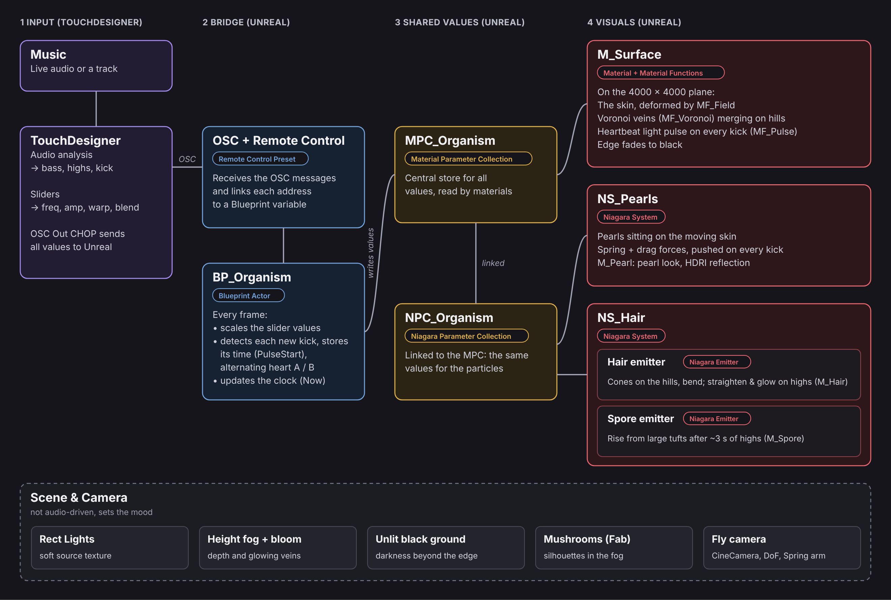

---
## Concept

I wanted to create an explorable music visualizer that evokes the feeling of entering the world of an abstract living organism, inspired by an interpretation of organic tissues and macro photography. I combined different structural elements to create visual variety and to provide more possibilities for mapping musical information to the organism’s behaviour. For the implementation, I thought about what audiofeatures could be represent which action:

> *Kick* – Intuitively felt like a heartbeat, so it pumps light, representing blood, through the veins from two hearts near the centre. With each kick, the pearls are also pushed away, intensifying the effect without deforming the veins or the surface.

> *Highs* – Represented by fine, grass-like hairs. Their straightening and subtle trembling suit the slowly emerging, shimmering high sounds. The highs also make the hairs glow and release spores, evoking an almost magical world.

> *Sliders* – Sliders in TouchDesigner (frequency, amplitude, warp, blend) reshape the surface live by blending between three mathematical functions, testing how to add a layer of interactivity from TouchDesigner.

Right now, the organism reacts in real time to an audio input. In the future, I would like to connect the system directly to a DAW, allowing the organism to be played live.

The name refers to the organism's appearance, like a living specimen from a laboratory experiment. The number "05" stands for both the fifth session of the course and Unreal Engine 5, which I used to create it.

---

## Implementation

### *1. TouchDesigner → Unreal Engine: Audio-Reactive Light Control via OSC – 8h*

I connected TouchDesigner to Unreal Engine via OSC so that audio analysis values (bass, highs, kick) control the intensity of three lights in real time through Remote Control.

**Problems**

1. Unreal Engine 5 received no OSC signals from TouchDesigner; the REC learn test returned `None`.
2. Once the connection worked, all three audio values arrived as the same signal.

**Solution**

1. The signal was blocked on `127.0.0.1` (localhost), and the OSC Data Format was set to `Time Slice` instead of `Sample`. Switched the IP to the IPv4 address (`192.168.178.131`), the port to `9000` and the Data Format to `Sample`.
2. All three TouchDesigner channels were internally named `low`, so they sent identical `/low` addresses. Renamed the channels to `low`, `high` and `kick` to generate distinct OSC paths (`/low`, `/high`, `/kick`).

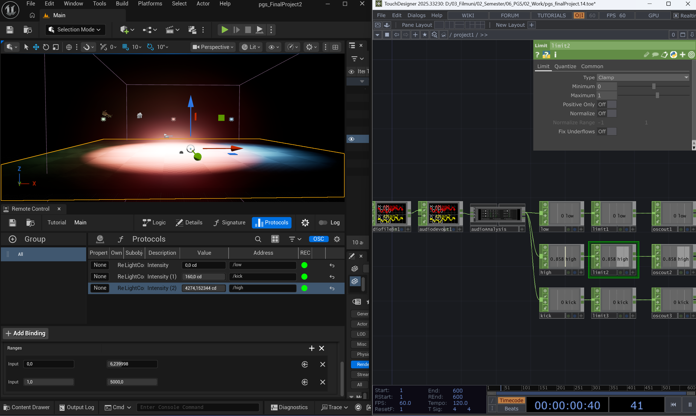

### *2. Concept Refinement & Unreal Engine Bridge for Material Parameters – 6h*

I refined my concept after seeing some mood images of abstract organic macro surfaces on Pinterest, inspired by microscopic tissue. their shapes felt defined by mathematical functions, which seemed perfect for this course. I plannes to implement Voronoi veins that run through a surface, and every kick should act as a heartbeat that sends a pulse of light through the veins.

To connect my OSC setup to the materials, I created a Material Parameter Collection (`MPC_Organism`) as a central store for all values, and a Blueprint (`BP_Organism`) that receives the OSC values via Remote Control and writes them into the collection every frame. The Blueprint also detects each new kick and stores its timestamp as `PulseStart`, which later animates the heartbeat pulse. 

<table>
  <tr>
    <td align="center">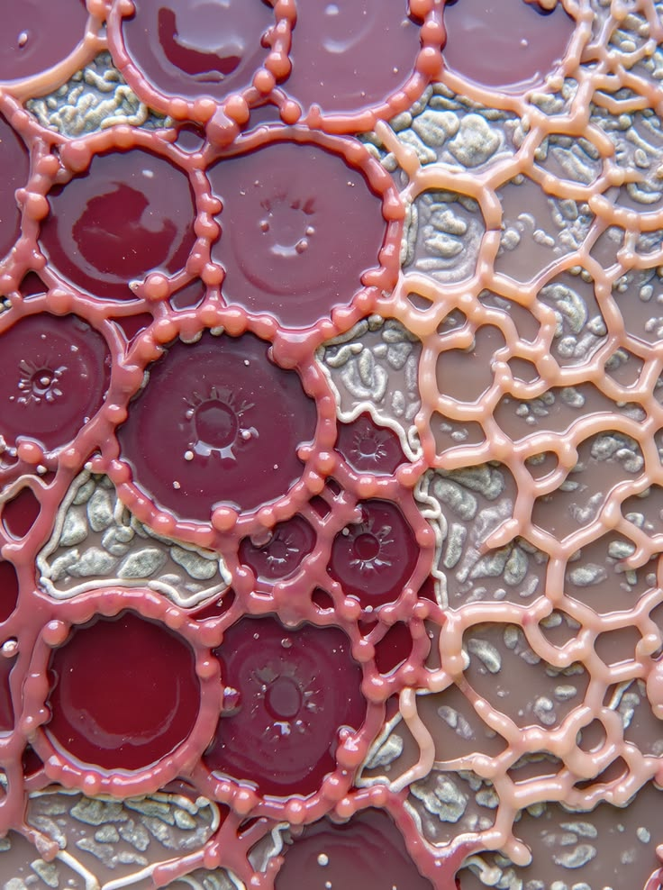</td>
    <td align="center">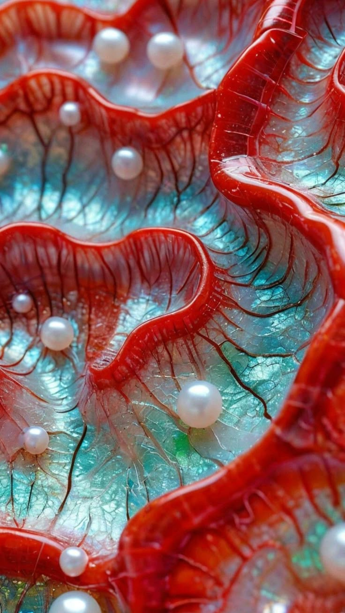</td>
    <td align="center">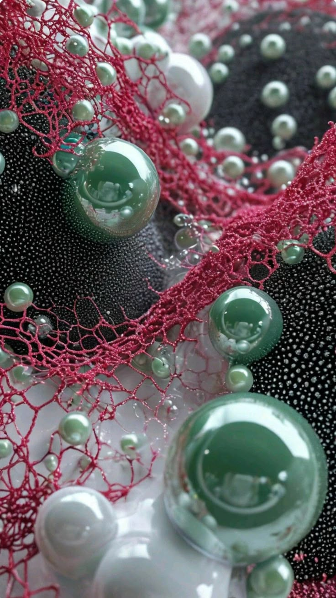</td>
  </tr>
</table>

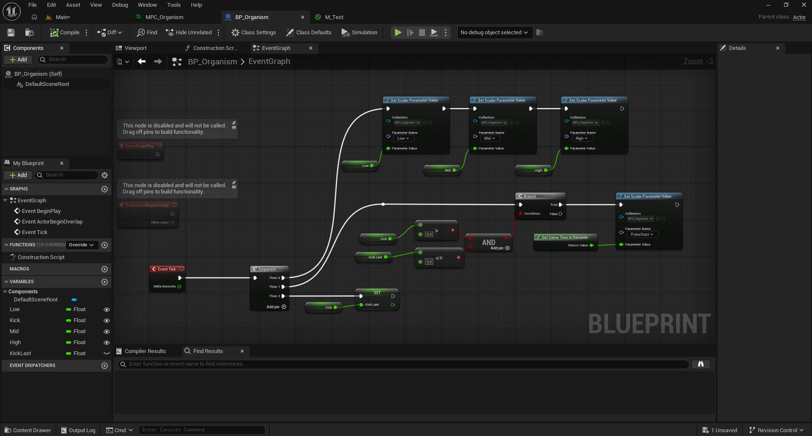

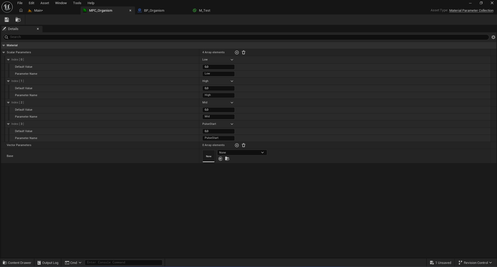

### *3. Material Functions & Live Control of the Function Parameters – 5h*

Next was building the mathematical core of the scene as reusable Material Functions in Unreal Engine. `MF_Field` calculates the height of the organic surface from three blended functions (crossed sine waves, a five-petal polar "flower" and ring waves), including a soft fade towards the edges. `MF_FieldNormal` derives the surface normals from the field, so the lighting follows the deformation. `MF_Mask` creates a soft circular region mask that later limits where the veins appear.

I also added a shared clock (`Now`), which the Blueprint writes into the Material Parameter Collection every frame, so that materials and particles stay in sync with the heartbeat. Finally, I set up live control: a Constant CHOP in TouchDesigner sends the function parameters (`freq`, `amp`, `warp`, `funcblend`) as values from 0 to 1 via OSC, and `BP_Organism` scales them to their actual ranges and passes them on to `MPC_Organism` (see Step 4).

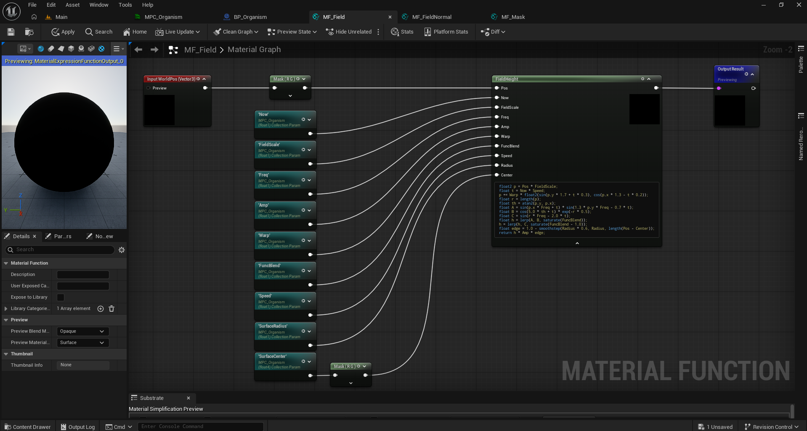

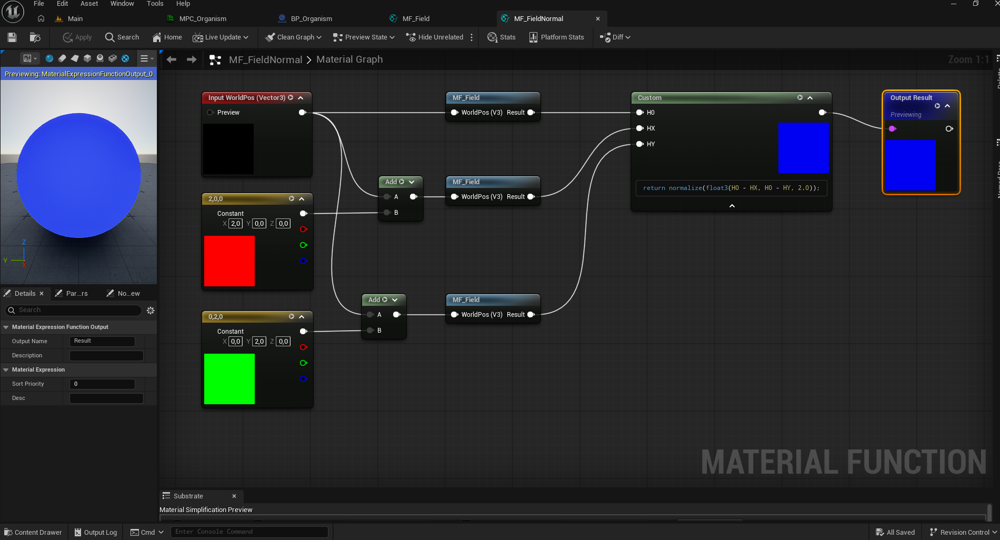

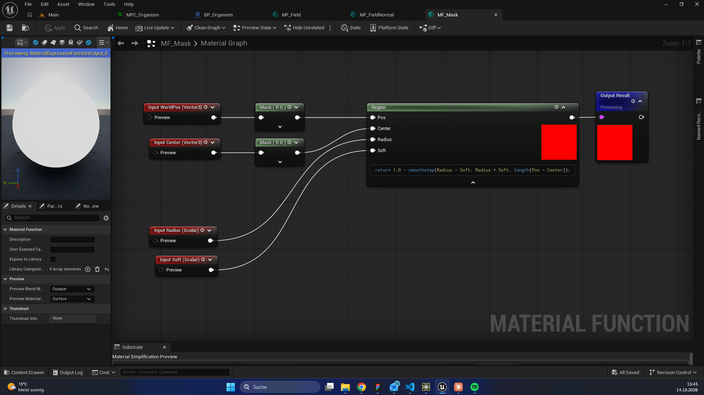

### *4. Organic Surface with Live Deformation – 3h*

I created a subdivided plane (2000 × 2000 units, 256 × 256 subdivisions) and built the material `M_Surface` with subsurface shading, to archieve a skin-like look. The Material deforms the plane with World Position Offset based on `MF_Field` and gets its lighting from the normals of `MF_FieldNormal`. The surface now moves in real time and can be reshaped live with the sliders in TouchDesigner (frequency, amplitude, warp and blending between the three functions).

**Problems**

1. The valleys of the surface appeared black with flickering, hard edges.
2. In Play mode the surface was completely flat, although it was deformed in the editor.

**Solution**

1. Everything below the original height of the plane was darkened: first the default level floor cut through the valleys, then Lumen still treated the area below the flat plane as "inside" the mesh, because its software ray tracing does not support World Position Offset. Deleted the default `Floor` and lifted the whole surface by `Amp` (`MF_Field` + `Amp`), so the valleys never sink below the original height.
2. The range mapping in Remote Control (0–1 → 0–100) did not convert the values, so `Amp` arrived as 0.4 instead of 40. Removed the Remote Control ranges and scaled the values in `BP_Organism` with Multiply nodes instead.

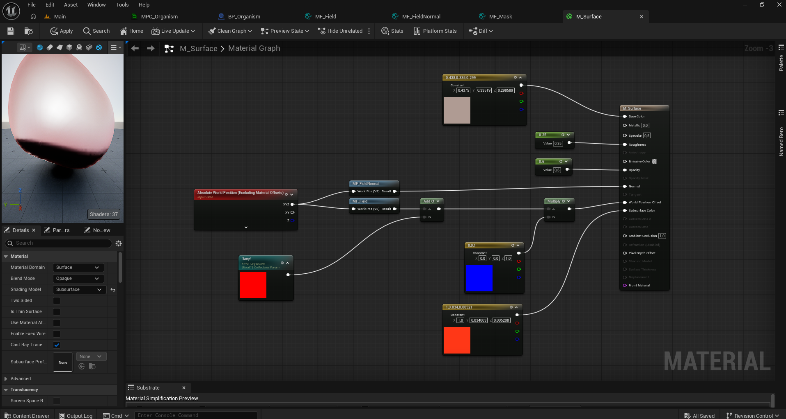

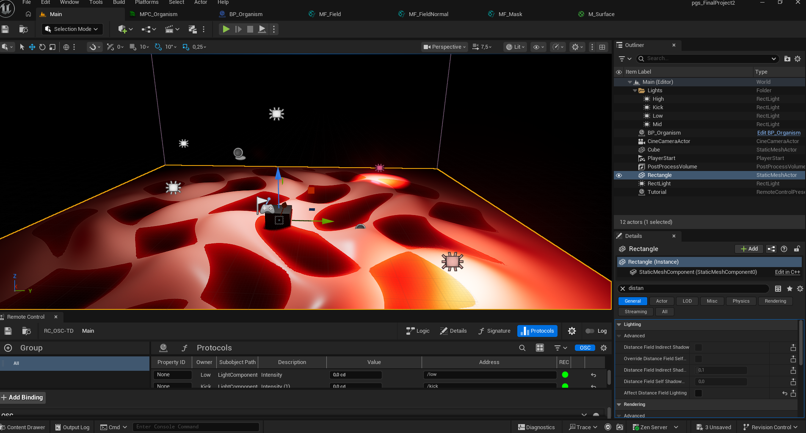

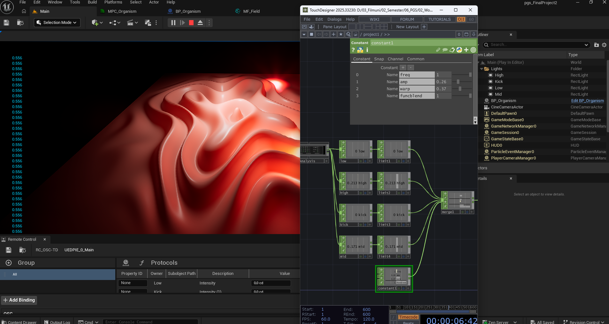

### *5. Voronoi Veins with Growth and Heartbeat Pulse – 9h*

I generated an organic vein network directly in the surface material using a Voronoi algorithm in a Custom HLSL node (`MF_Voronoi`), created with the help of claude and reviewed by me. The cell edges form the veins, a finer second Voronoi layer adds capillaries, and domain warping makes the cells look grown rather than geometric. The veins are colored, slightly raised from the skin, and limited to a circular zone by `MF_Mask`.

The heart of the step is `MF_Pulse`: on every kick, the Blueprint stores the current time as `PulseStart`, and the material sends a ring of light from the heart outwards through the network, cell by cell, fading over time. A `Growth` parameter lets the network grow outwards from the heart. Two hearts alternate on every kick (`UseA` toggle in `BP_Organism`), so the waves overlap and the rhythm feels more alive. To make the veins look truly raised, I added a bump-mapping Custom node (`VeinBump`) that bends the surface normals along the veins, so they catch light and cast shading.

**Problems**

1. After reopening the project, `Amp` could no longer be controlled from TouchDesigner, although all other sliders still worked.
2. The veins looked flat, even with a higher `VeinHeight`.

**Solution**

1. The Remote Control preset contained two OSC bindings for `Amp` that blocked each other. Deleted the duplicate binding and saved the preset separately.
2. The lighting only used the normals of the large field, and the mesh (256 × 256 subdivisions) was too coarse to displace such thin lines geometrically. Added the vein height to the normals with a bump-mapping Custom node (screen-space derivatives of the vein height), so the veins get their own highlights and shadows.

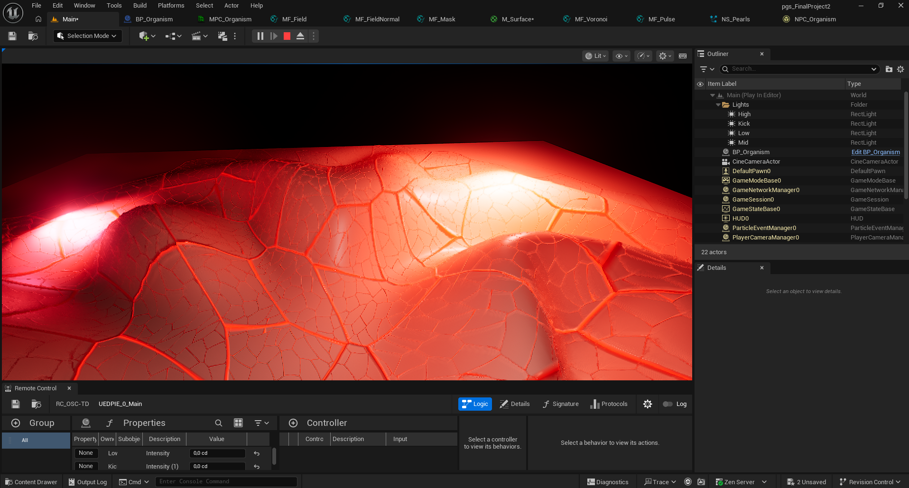

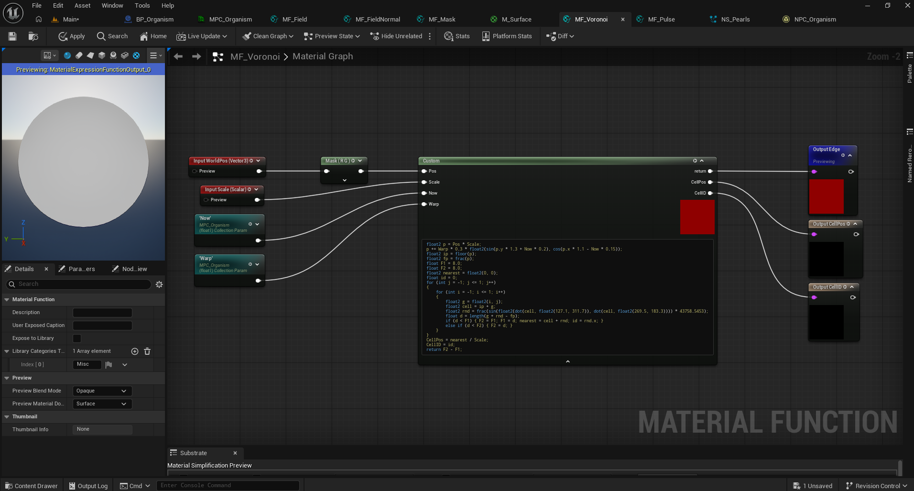

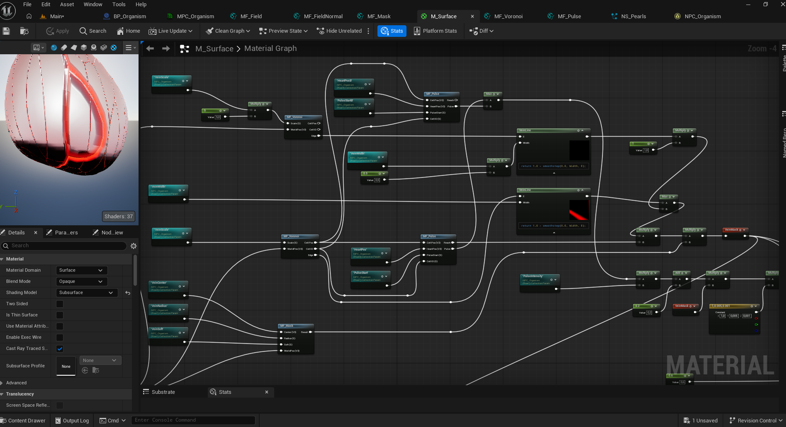

### *6. Pearls in Niagara with Forces and Heartbeat Push – 5h*

Next I created a particle system (`NS_Pearls`) that places pearl-like spheres on the organic surface. Each pearl remembers its starting position (`RestPos`) when it spawns. All movement happens in a single Scratch Pad module with a Custom HLSL node. The node evaluates the same field function as the surface material, so every pearl sits exactly on the moving skin. A spring pulls the pearls back to their rest position, drag calms the motion, and pearls are only visible in the valleys of the surface. On every kick, the heartbeat wave pushes the pearls away from the heart and makes them swell briefly, perfectly in sync with the light pulse in the veins. The values come from the shared `MPC_Organism` via a Niagara Parameter Collection (`NPC_Organism`). The pearls use a clear-coat material with a Fresnel-based shimmer from pink to green and cast shadows onto the skin.

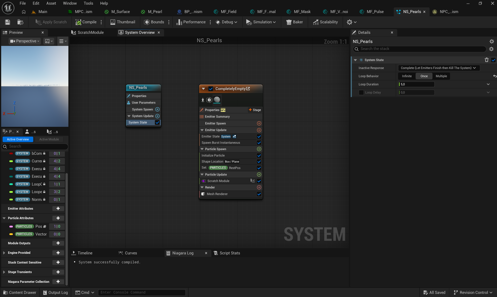

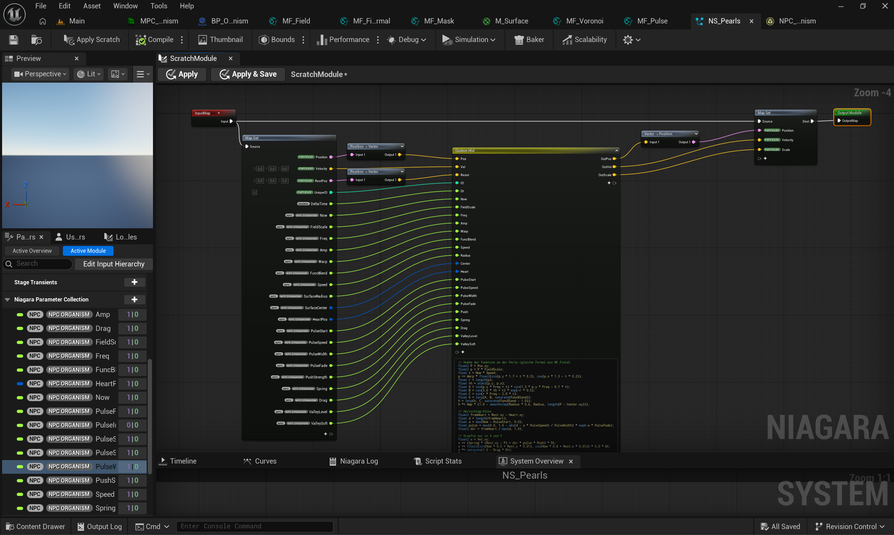

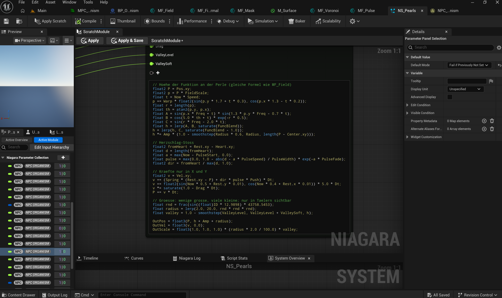

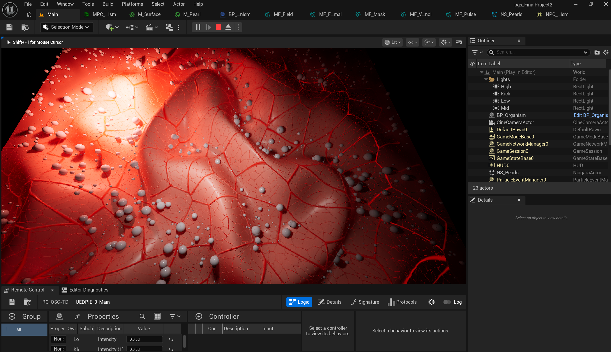

### *7. Organic Voronoi and Two Material Zones – 8.5h*

The vein net looked too evenly distributed, so I wanted a stronger contrast with large cells on the hills and a fine structure in the valleys. The net now reacts to the height of the surface, and the material was split into dark red valleys and light blue hills. In addition, the pearls are now pushed by both hearts. Since the graph had grown to a cluttered node tree with around 140 nodes, I had Claude rebuild it as copy-paste text (Unreal's T3D format), grouped into labelled comment boxes with adjustable Constants and colour pickers. This kept it readable and made it much faster to try out visual options.

**Problems**
1. Blending three Voronoi layers produced broken veins, straight seams, very thin cells and restless motion.
2. Fading out veins depending on the height created a visible straight line between the red and light areas, and some veins ended abruptly.
3. The gradient between red and blue looked patchy and had jagged edges.

**Solution**

While researching these issues, I learned that separate Voronoi layers cannot connect to each other and that fading only hides veins instead of changing the network itself. The final solution uses two simple Voronoi networks, a fine and a coarse one, in a single Custom HLSL node. Each fine cell merges depending on the height at its centre, and its walls gradually thin out and disappear once both neighbouring cells have merged. The coarse network only appears where cells have merged, so a large cell can border many small ones while every visible vein stays connected.

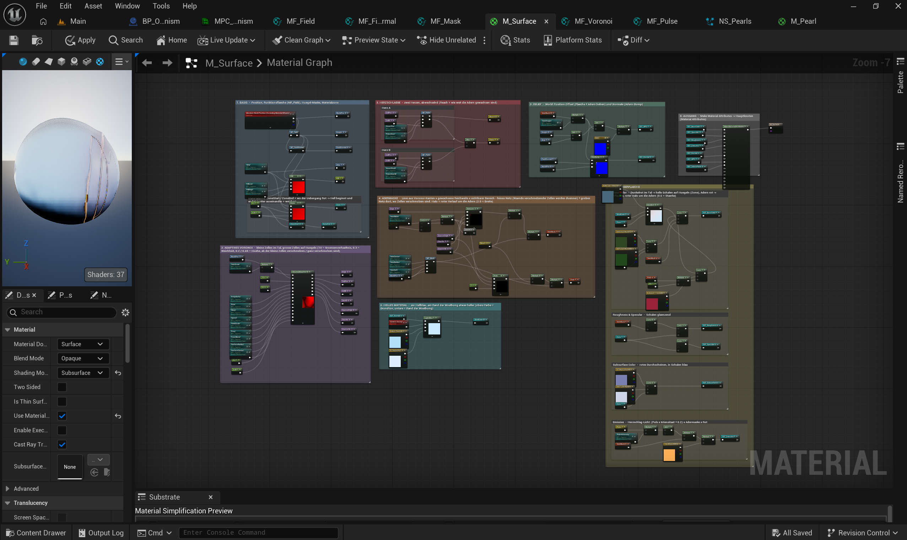

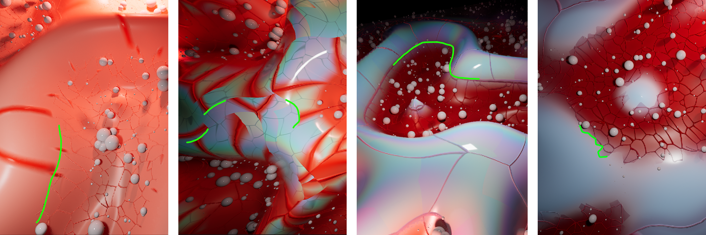

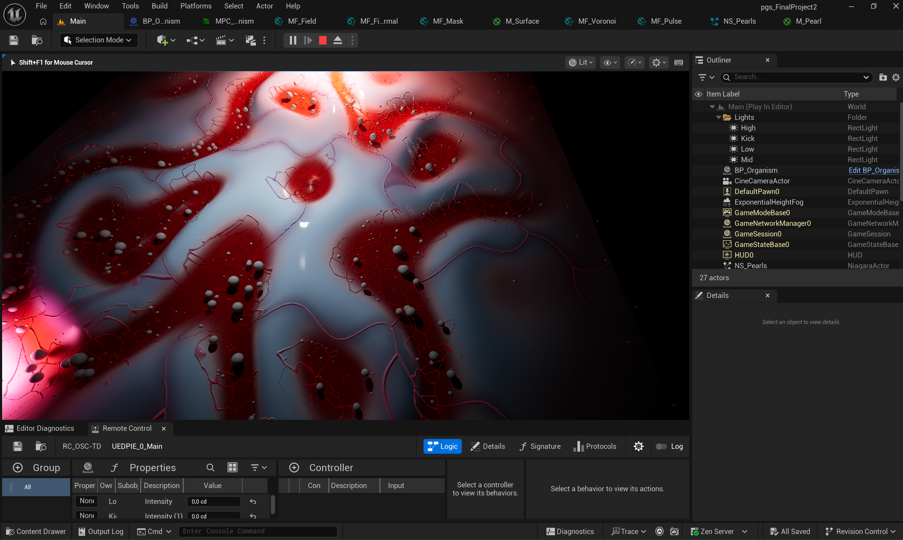

### *8. Hairs on the Hills – 4h*

To give the hills a soft, furry texture, I added a second Niagara system (`NS_Hair`) based on the pearl system. Thin cone meshes grow only on the hills, gathered in tufts with a few single hairs in between. At rest they curve downwards, and high frequencies make them straighten up and tremble. A scratch pad module calculates each hair's position, length, orientation and bend, and the material `M_Hair` bends the cone along an arc via World Position Offset. A subtle emissive gradient towards the tip gives the hairs depth instead of a flat glow.

**Problems**
1. The bend values calculated in Niagara could not be passed directly to the material.
2. The arc bend requires each hair's actual length, which varies per hair and was not available in the material.

**Solution**
1. As the material's Dynamic Parameter cannot be written to in the Map Set node, I stored the values in custom particle attributes (Particles.BendX, Particles.BendY) and forwarded them with the "Dynamic Material Parameters" module.
2. The material determines the length itself by transforming the cone axis (0, 0, 100) from local to world space and taking the vector's length, which already includes the particle and Mesh Renderer scale.

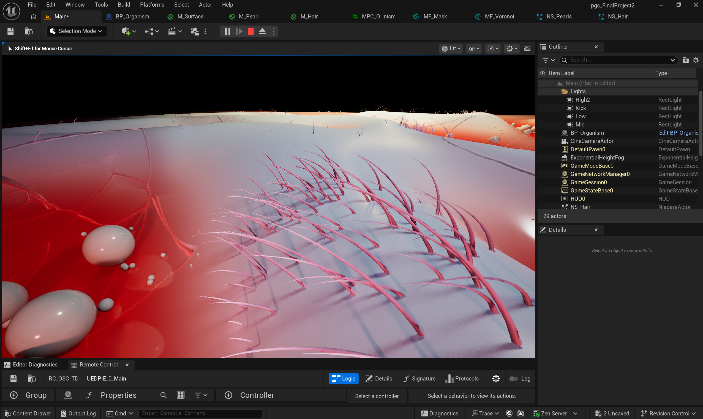

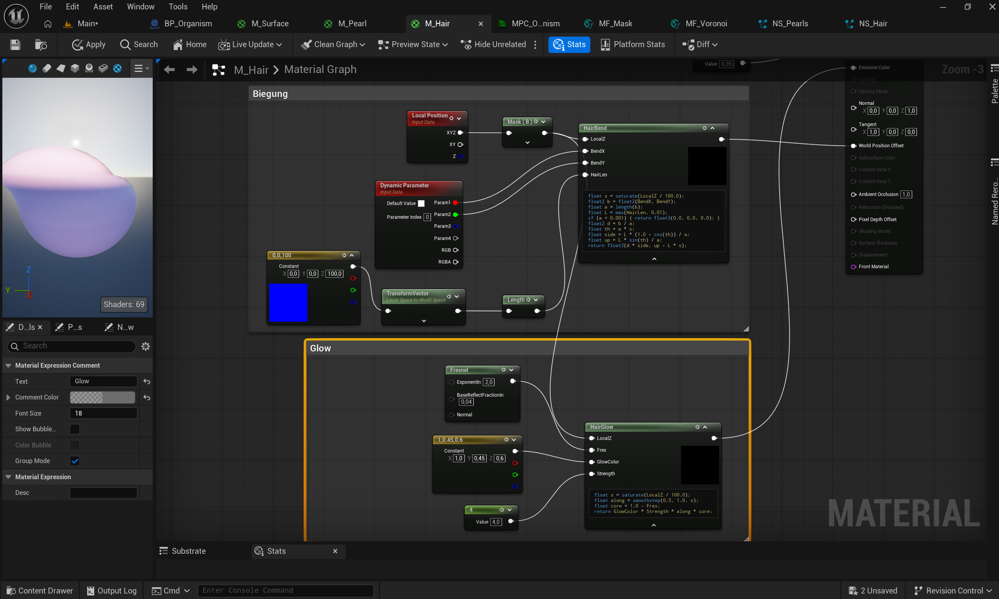

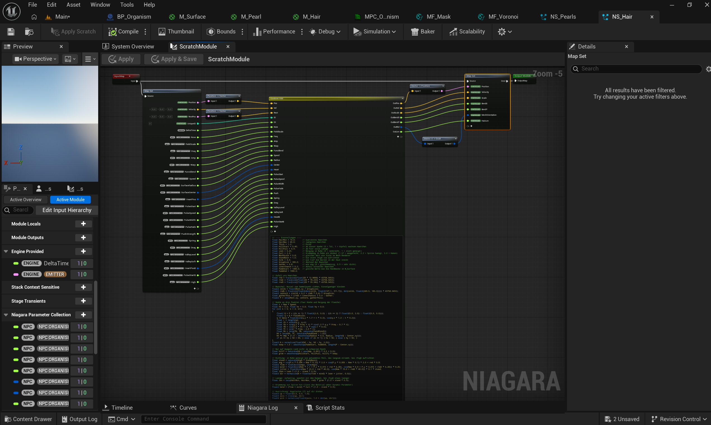
 
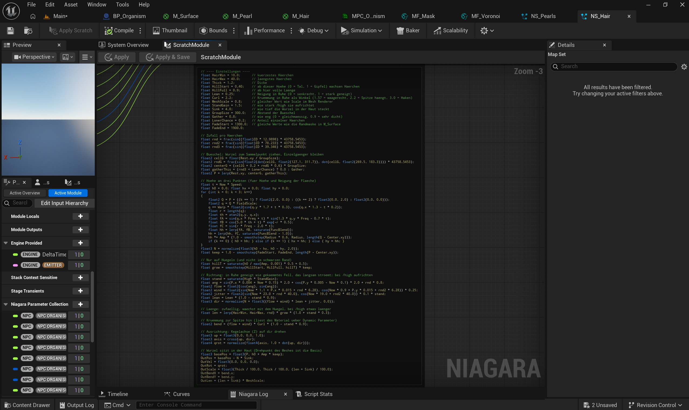

### *9. Hiding the Edges – 1.5h*

Until this point, the surface ended in a visible straight edge, which broke the illusion of an endless organism. To conceal it, I enlarged the plane to 4000 × 4000 units and added an edge mask to `M_Surface`. Beyond a defined distance from the centre (FadeStart 1300, FadeEnd 1900), the surface gradually flattens, and its colour, specular, subsurface and emission fade to black. A black ground plane beneath it continues this darkness, so that the organism appears to dissolve into the void. Finally, the vein area and growth radius in the Material Parameter Collection were extended to match the new size.

**Problems**
1. The larger surface noticeably increased the rendering cost, even in areas that end up completely black.
2. The pearls and hairs ignored the fading edge: pearls floated above the sunken surface, and hairs kept growing in the black area.

**Solution**
1.  I made the Voronoi calculation stop early outside the edge mask and kept the plane's resolution moderate (512 subdivisions).
2. I added the same mask with identical values to both Niagara modules, so the pearls sink together with the surface and the hairs shrink to nothing towards the edge.

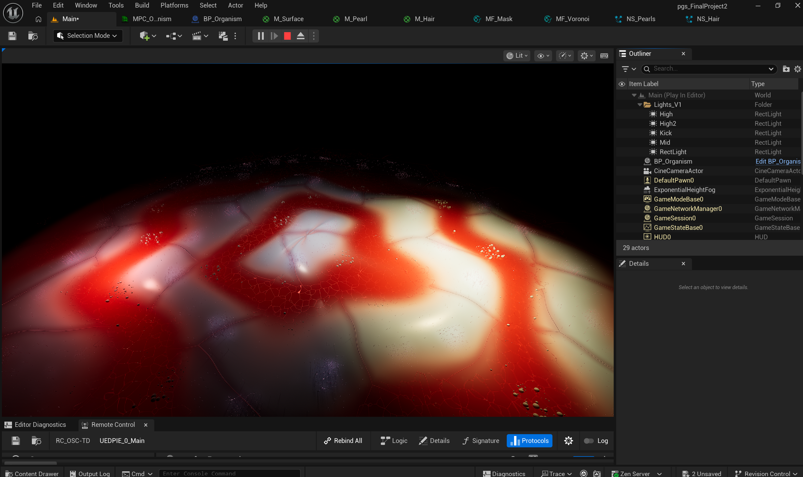

### *10. Lighting, Material Look and Camera – 7h*
It was finally time to style the system ◝(ᵔᵕᵔ)◜ and give the scene more athmosphere. The valleys now appear wet and slimy through very low roughness, high specular and a stronger red subsurface scattering with reduced opacity, while the bright shells received a slightly rougher, waxy finish. For the lighting, I combined Rect Lights with an exponential height fog to create depth, and used bloom to make the pulsing veins glow. Beyond the planned changes, the hairs now also light up in response to high frequencies. Instead of an animated camera, I built a free-flying camera that keeps the cinematic depth of field, allowing me to move through the organism live.

**Problems**
1. The Sky Light made the edges of the black ground visible, and it cannot be restricted to individual objects.
2. The default play camera offered neither depth of field nor the ability to look around freely with a cinematic lens.

**Solution**
1. To keep the studio reflections on the pearls, I sample the HDRI directly in their material using the reflection vector and a Fresnel mask..
2. I created a custom pawn based on the DefaultPawn with an attached CineCamera and set it as the default pawn via a game mode. 

### *11. Rising Spores and Final Touches – 4h*

As a last addition, the large tufts of hair now release subtle glowing spores once high frequencies have been playing for a while. The spores are a second emitter inside NS_Hair, rendered as small additive sprites that fade in quickly and slowly dissolve over their lifetime. A scratch module places each spore inside a tuft, using the same grouping logic as the hair roots, and only keeps spores from the largest, densest tufts on top of the hills.

Furthermore, I reshaped the tufts themselves from square patches into round, slightly irregular clusters, which looks more organic. I also placed free mushroom models from the Fab library in the fog around the surface. They only appear as faint silhouettes and create depth beyond the edge of the organism. Finally, I attached the free-flying camera to a spring arm with rotation lag, which smooths out the mouse movement and makes camera pans feel more cinematic.

**Problems**
1. After copying the hair module into the spore emitter, both emitters shared the same script. Every change affected the hairs, and the spores ran the hair code, rising in two narrow beams.
2. Spores were supposed to come only from large tufts, but appeared everywhere on the hills.

**Solution**
1. In Niagara, copying a module only creates a second reference to the same script. I created a new, separate scratch module and copied only its nodes, which are independent. 
2. Each spore is placed in a random tuft, and the module checks the tuft's size with the same formula as the hair length. Spores in small tufts are removed immediately, so only the largest tufts release them.

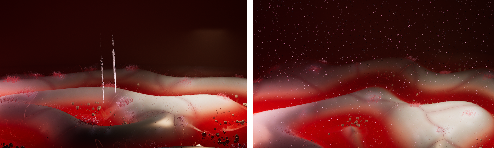

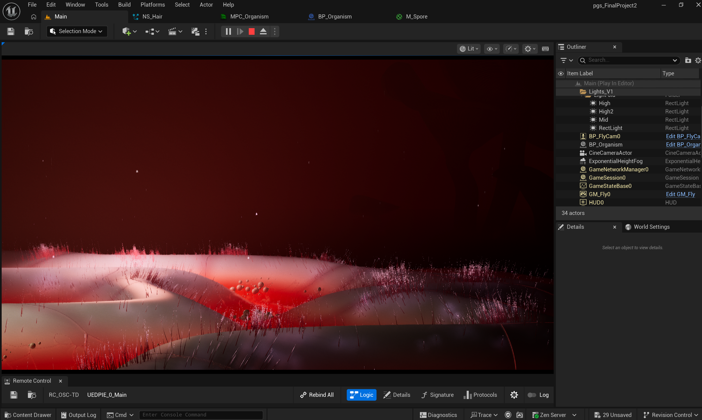

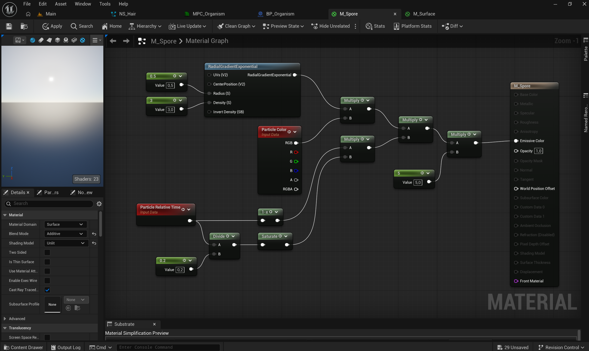

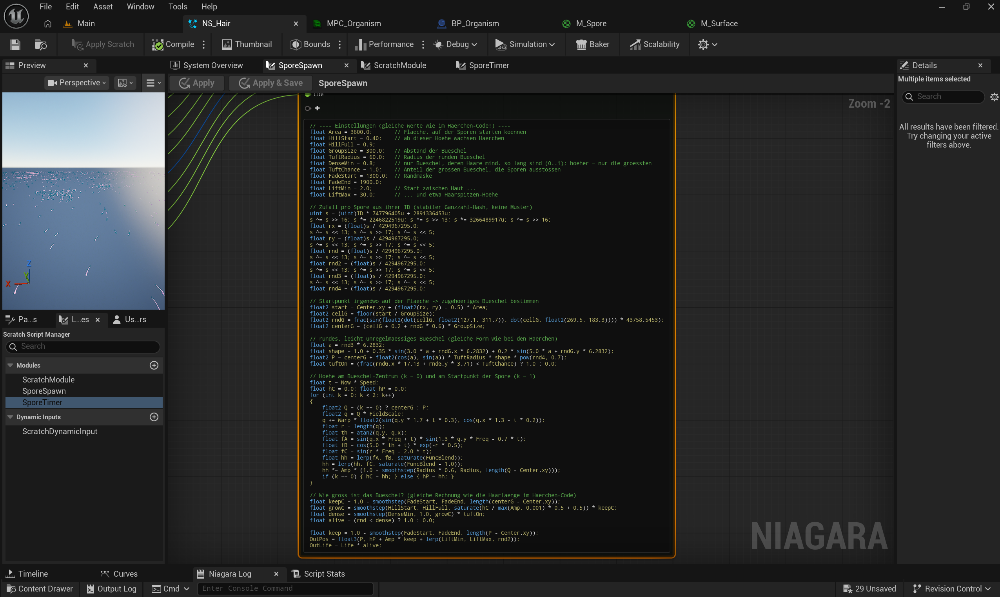

### *Documentation and Preparing Submission – 5h*

Resources

#### Step 1:
- [YouTube – Tutorial by Nils Gallist on TouchOSC x Unreal Engine 5](https://www.youtube.com/watch?v=YjEBCUAO7ec)
- [YouTube – Tutorial by The interactive & Immersive HG on Controlling Lights in Unreal Engine via OSC from TouchDesigner](https://www.youtube.com/watch?v=PQAeUkcykVo&list=PLpuCjVEMQha_EVqrQeiuCi5HGBbtsrkJk)
- [Gemini – Bug fixing](https://gemini.google.com/app)
- [Claude – Bug fixing and guiding](https://claude.ai/new)

#### Step 2:
- [Claude – Bug fixing and guiding](https://claude.ai/new)
- [Unreal Engine Docs – Using Material Parameter Collections](https://dev.epicgames.com/documentation/unreal-engine/using-material-parameter-collections-in-unreal-engine)
- [Unreal Engine Docs – Getting Started with Remote Control Presets](https://dev.epicgames.com/documentation/en-us/unreal-engine/getting-started-with-remote-control-presets-in-unreal-engine)

#### Step 3:
- [Claude – Bug fixing and guiding](https://claude.ai/new)
- [Unreal Engine Docs – Material Functions](https://dev.epicgames.com/documentation/en-us/unreal-engine/material-functions-in-unreal-engine)
- [Unreal Engine Docs – Custom Material Expressions (HLSL)](https://dev.epicgames.com/documentation/en-us/unreal-engine/custom-material-expressions-in-unreal-engine)
- [Unreal Engine Docs – Material Parameter Expressions (Collection Parameter)](https://dev.epicgames.com/documentation/en-us/unreal-engine/material-parameter-expressions-in-unreal-engine)
- [Unreal Engine Docs – Remote Control Protocols (OSC)](https://dev.epicgames.com/documentation/unreal-engine/remote-control-protocols-in-unreal-engine?lang=en-US)
- [TouchDesigner Docs – OSC Out CHOP](https://derivative.ca/UserGuide/OSC_Out_CHOP)

#### Step 4:
- [Claude – Bug fixing and guiding](https://claude.ai/new)
- [Unreal Engine Docs – Lumen Technical Details](https://dev.epicgames.com/documentation/en-us/unreal-engine/lumen-technical-details-in-unreal-engine)

#### Step 5:
- [Claude – Bug fixing and guiding](https://claude.ai/new)
- [The Book of Shaders – Cellular Noise (Voronoi)](https://thebookofshaders.com/12/)
- [Unreal Engine Docs – Custom Material Expressions (HLSL)](https://dev.epicgames.com/documentation/en-us/unreal-engine/custom-material-expressions-in-unreal-engine)
- [Morten S. Mikkelsen – Bump Mapping Unparametrized Surfaces on the GPU](https://hgpu.org/?p=3263)

#### Step 6:
- [Claude – Bug fixing and guiding](https://claude.ai/new)
- [Unreal Engine Docs – Niagara Scratch Pad Modules](https://dev.epicgames.com/documentation/en-us/unreal-engine/niagara-scratch-pad-modules-in-unreal-engine)
- [Unreal Engine Docs – Render Module Reference for Niagara (Mesh Renderer)](https://dev.epicgames.com/documentation/en-us/unreal-engine/render-module-reference-for-niagara-effects-in-unreal-engine)
- [Unreal Engine API – Niagara Parameter Collection](https://dev.epicgames.com/documentation/unreal-engine/API/Plugins/Niagara/UNiagaraParameterCollection)

#### Step 7:
- [Claude – Bug fixing and guiding](https://claude.ai/new)
- [Unreal Engine Docs – Custom Material Expressions (HLSL)](https://dev.epicgames.com/documentation/en-us/unreal-engine/custom-material-expressions-in-unreal-engine)
- [Unreal Engine Docs – Material Attributes Expressions](https://dev.epicgames.com/documentation/en-us/unreal-engine/material-attributes-expressions-in-unreal-engine)
- [Inigo Quilez – Voronoi Edges](https://iquilezles.org/articles/voronoilines/)

#### Step 8:
- [Claude – Bug fixing and guiding](https://claude.ai/new)
- [Unreal Engine Docs – Niagara Scratch Pad Modules](https://dev.epicgames.com/documentation/en-us/unreal-engine/niagara-scratch-pad-modules-in-unreal-engine)
- [Unreal Engine Docs – Custom Material Expressions (HLSL)](https://dev.epicgames.com/documentation/en-us/unreal-engine/custom-material-expressions-in-unreal-engine)

#### Step 9:
- [Claude – Bug fixing and guiding](https://claude.ai/new)
- [Unreal Engine Docs – Using Material Parameter Collections](https://dev.epicgames.com/documentation/unreal-engine/using-material-parameter-collections-in-unreal-engine)

#### Step 10:
- [Claude – Bug fixing and guiding](https://claude.ai/new)
- [Poly Haven – Free HDRIs (studio HDRI used for the pearl reflections)](https://polyhaven.com/)
- [YouTube – UE5 Tutorial: Create a Flying Pawn using a Character Pawn (not raw pawn)](https://www.youtube.com/watch?v=FRwcxhF35Ig)

#### Step 11:
- [Claude – Bug fixing and guiding](https://claude.ai/new)
- [Unreal Engine Docs – Render Module Reference for Niagara (Sprite Renderer)](https://dev.epicgames.com/documentation/unreal-engine/render-module-reference-for-niagara-effects-in-unreal-engine)
- [Fab – "Mushroom on Tree_Baked Lighting Map" by Armored Interactive (free asset)](https://fab.com/s/ef35333cf42d)

## Results

### [>> Link to the final Demo Video (っᵔ◡ᵔ)っ](https://owncloud.gwdg.de/index.php/s/cEn2Tans2hgCURr) 

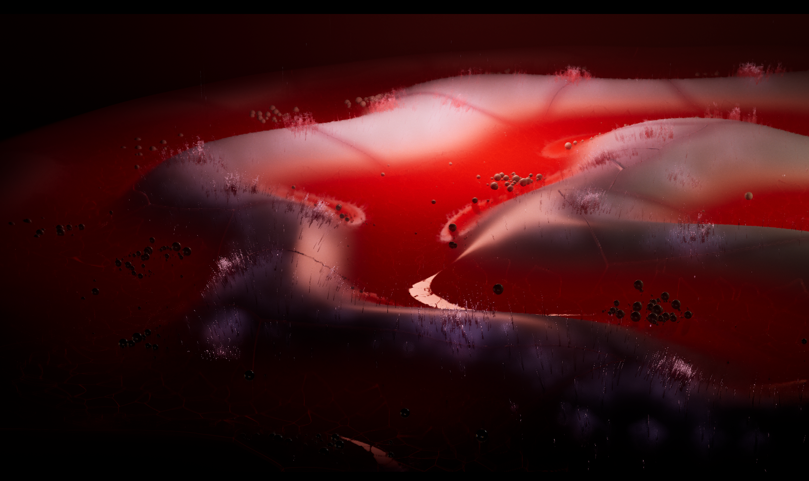
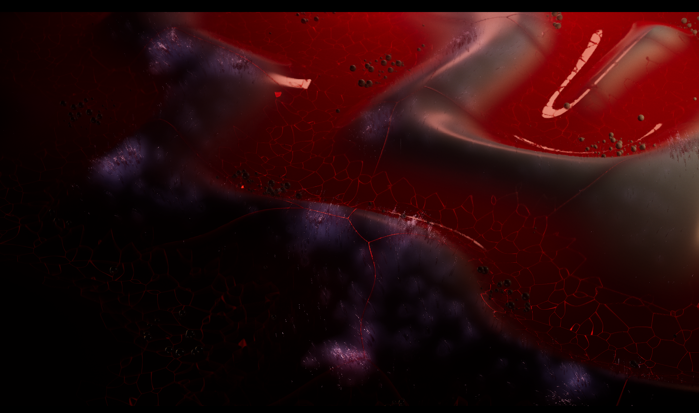

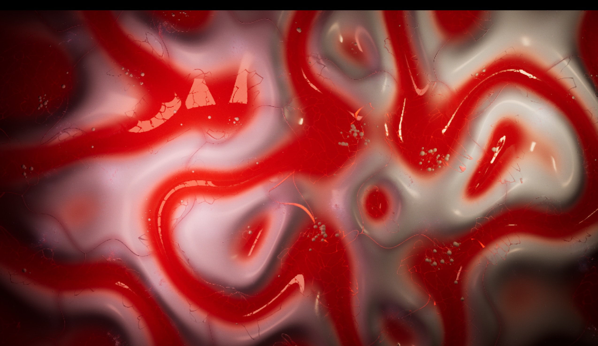
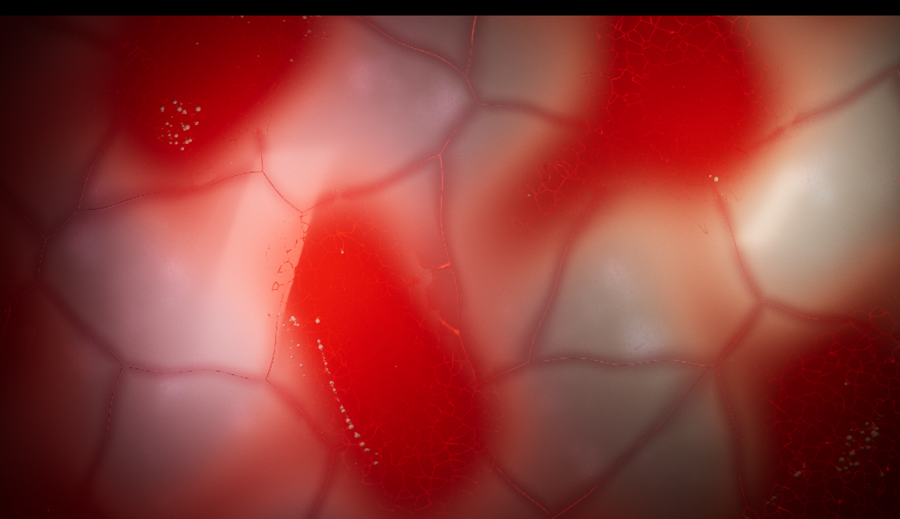
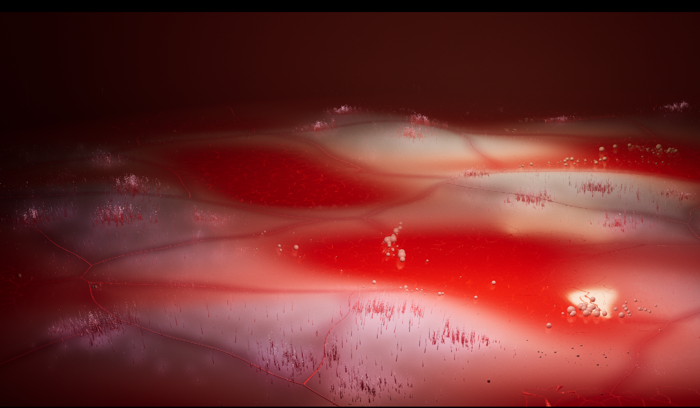
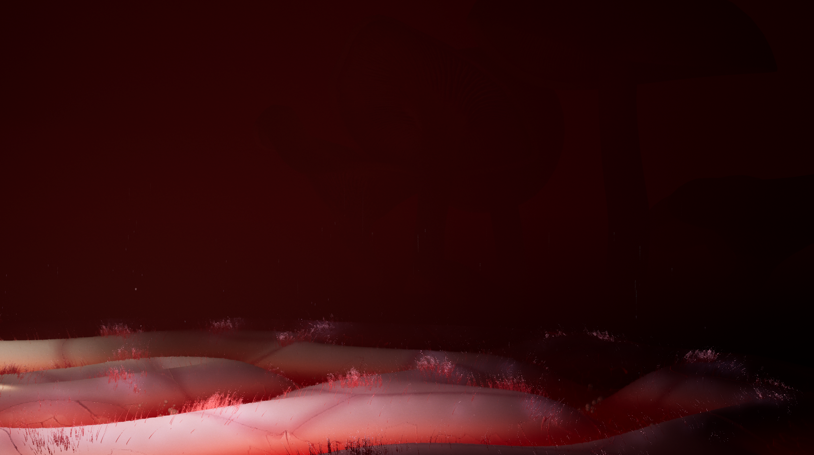

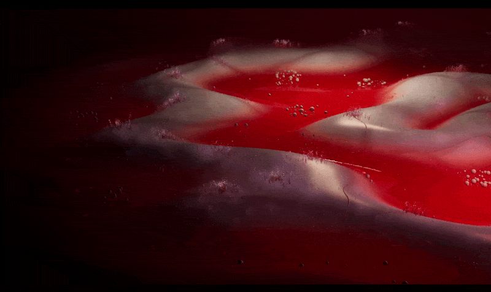

## Project Reflection & Discussion

This project was a great introduction to Unreal Engine and to procedural generation and simulation, as it showed me the key advantages of such systems. The form can change and react in real time, existing systems can be reused for new purposes, and everything scales without having to be rebuilt.

Without Claude, the project would have turned out very differently and much smaller. Finding the right combination of Unreal's internal systems to realise my specific concept would have taken me a long time on my own. Instead, I created my own step-by-step tutorial with Claude, asked for the reasoning behind every step and followed up whenever something was unclear. I also asked for helpful online references along the way. Still, every new project remains a test of my own limits when working with AI, and of how much I can and want to integrate it into my workflow while still learning.

For my previous level of Unreal Engine knowledge, the project became fairly complex. Nevertheless, I learned more than from many Blender tutorials I followed in the past, which showed the steps but rarely explained why they mattered. Since the system repeatedly uses similar building blocks, I carried out many steps several times and internalised the workflow. By the end, I could navigate Unreal Engine with confidence, understood the purpose of many components and had a sense of which additional features would fit well into the system. Overall, I am satisfied with the result and motivated to explore this direction further.

## Lessons Learned

- At the start, I learned how to build a real-time pipeline between TouchDesigner and Unreal Engine, and what OSC is and what it is used for.
- Connecting the two programs showed me how Unreal receives values and passes them between different systems, such as Blueprints and Parameter Collections.
- Building the surface introduced me to field functions, which return a value for every point in space.
- Through this, I began to think of a scene as a set of functions and systems rather than individual objects.
- Writing Custom nodes gave me a basic understanding of shader programming with HLSL.
- With the veins, I learned how a Voronoi function is built and how its parameters shape the result.
- The difference between vertex and pixel shaders became clear when i head errors with `ddx` and `ddy` in the World Position Offset.
- Working with Niagara taught me how namespaces, scratch pad modules and emitter life cycles work, and that copied modules share one script.
- When hiding the edges, I started to consider performance, for example by stopping calculations early instead of covering them with fog.
- Throughout the project, debugging became my most important skill, by isolating one problem at a time, testing assumptions and making values visible through colour.
- I also refined my use of AI as a tool. Claude wrote large parts of the HLSL code, but I had to describe problems precisely, understand the code well enough to adjust it and recognise when a solution did not fit my concept.
- Finally, I saw how my concept developed iteratively, as many ideas such as the merging Voronoi cells or the spores only came up while working with the system.

One important lesson I learned is to trust the process. Especially when working with AI, turning my own concept into reality required clear explanations and constant refinement along the way. Building the node trees often took a long time without knowing whether the result would work or look the way I had imagined. As in most projects, I first had to get my rough idea working and trust that the visual refinement at the end would bring it together.

## Wrap-Up - 3 Points

### Task 05.02 - Feedback

Please answer the following questions briefly so that I can further improve the lecture for future students.

*Submission*:

**How would you rate the difficulty of this lecture from 1 (far too easy) to 5 (far too difficult)?**
- **3 out of 5.** It was sometimes challenging to follow the logic behind certain concepts or mathematical equations, but I never felt overwhelmed. I always felt that I would be able to build on what I had learned if I wanted to explore a topic further.

**How would you rate the amount of work you had to put into this lecture so far from 1 (no work at all) to 5 (far too much work)?**
- **3 out of 5.** Homework always feels like extra work, but it helped me stay on track, figure out which direction I wanted to pursue in my project and deepen my understanding of the topic.

**How well did the given time estimates for each session match the time you needed to complete the session?**
- Most of the time, it took me a bit longer.

**What do you think about Unreal as tool to learn for a CTecht & VFX student? Is it valuable?**
- I liked it a lot and found it highly valuable, as it opens up slightly different areas of application than Unity.

**What do you think about Unreal as a tool for this class?**
- It works really well, because it offers a different approach to Unreal Engine. Instead of designing a world, I was thinking about creating a system.

**Do you have any other ideas reading which tools and software packages to use for this class?**
- Maybe Blender's Geometry Nodes, but since most students already use Blender, I think it is good to include Unreal in the lessons.

**Do you have any useful hints to pass on to future students, e.g. utility tools, or further resources?**
- Unfortunately not. :(

**What is your opinion regarding practical exercises in class? Did they fit? Did you enjoy working on them?**
- Yes, I liked them, but I would not spend more time on them than we did. Learning software at home is more efficient for me, although working on it together in class lowers the barrier to getting started.

**How did the practical exercises fit the theoretical topics of the class?**
- They fit very well and were definitely necessary. It is important to find our own way to connect with the topic and to identify our specific use case for it, which kept me motivated.

**Did you enjoy working on the practical exercises? If not, why not?**
- Yes, for the reasons mentioned above.

**Do you think the practical exercises where beneficial for your learning?**
- Yes, I think so.

**Which one was your favorite chapter, and which one was your least favorite?**
- My favourite was probably Function Design, as it gave me background knowledge on things I had already used before, which I found very interesting. I did not have a least favourite, since everything was interesting.

**Was there a topic missing and if so which one?**
- Not really

**Are there any other artists that would fit to the class content and that would be worthwhile to discuss in class?**
- [cloud.i0](https://www.instagram.com/cloud.i0/) is definitely a bit weird, but an interesting example.
- I also like [this project by d__u__s__s__o_____l__a__b__s](https://www.instagram.com/p/Deo3kxCzNfi/) (TRIGGER WARNING, if you dislike bugs).

**Please feel free to add any feedback you want to give!**
- I really enjoyed the course and found it challenging but also highly relevant. Thank you for that! :)

## Learnings - 10 Points

### Task 05.03.01

Summarize your learnings within the course in whole sentences. What was challenging for you during this course? How did you challenge yourself?

### What I Learned

- I learned to see the mathematics behind the structures and shapes around me more clearly.
- I gained a better understanding of what true randomness is, and how computers instead use pseudo-random functions.
- I learned how different interpolation types work, from simple linear blending to smooth curves such as smoothstep, and how they change the character of a transition.
- I now understand where the different noise types come from, such as value noise, Perlin noise and cellular noise, and what makes each of them look different.
- I learned which elements make up a force, such as its direction, strength and the mass it acts on.
- I learned not to be afraid of integrating procedural systems into my workflow, and discovered many use cases I had never thought of before.
- It was very exciting to finally understand the technical and mathematical background of functions I have been using for years.

### Challenges

- Overall, the course was challenging for me, as mathematics has never been one of my strengths and following the formulas was not always easy.
- Reading and working with code is still a challenge for me as a beginner, but I can feel it becoming easier.

### How I Challenged Myself

I challenged myself mainly through curiosity. I started with a visual idea that connected several of the course topics, without knowing whether I would be able to make it work. Again and again, I wanted to connect more building blocks and create a more complex system. After every step, I asked myself whether I could implement one more idea and whether I could make it even better. Unreal Engine, with its many possibilities (and of course the help of Claude), allowed this curiosity, and in the end everything worked. That was a really rewarding experience!

### Task 05.03.02

To make the best possible use of the lecture, please reflect on the following questions.

Does it make sense for you

* ...to have procedural generation in your set of skills? If yes, 
    * with which tool do you want to work with?
    * which outputs / designs / setups are you aiming for?

Yes, it makes a lot of sense for me. I want to work with a range of tools, such as Blender's Geometry Nodes, plain code, Unreal Engine and TouchDesigner. I am mainly aiming for interactive visuals that I could use in installations or for VJing. In the future, I would like to combine even more programs and explore what is possible in this field. For me, procedural systems open up a whole new set of possibilities, as they overcome the limitations of software that does not offer this kind of flexibility. Additionally, I want to see how to use procedural systems and values within that, to get abstract and unexpected outcomes like this artworks i found from [procedural_disarray](https://www.instagram.com/p/DVGk44UCAd5/) or the work from [cloud.i0.](https://www.instagram.com/cloud.i0/)

* ...to have Unreal in your set of skills? If yes, 
    * which Unreal topic so you want to look into next?
    * which outputs / designs / setups are you aiming for?

Yes, it definitely makes sense for me. I love that Unreal works in real time, and coming from Blender's Material and Geometry Nodes, it also feels more natural to me than Unity, even though Unity is still the industry standard for many mixed reality projects. Next, I would like to look into simulations driven by camera input or sound, and to experiment with MetaHumans. My next big Unreal project will be some kind of digital twin, in which sensor data drives a model or system in real time. I am also interested in combining real-world information, such as shadows and lighting conditions, with the virtual scene, like in [this cool project.](https://www.instagram.com/p/DeB5R7DhJjC/) 

 

---

**Happy Finalizing!**