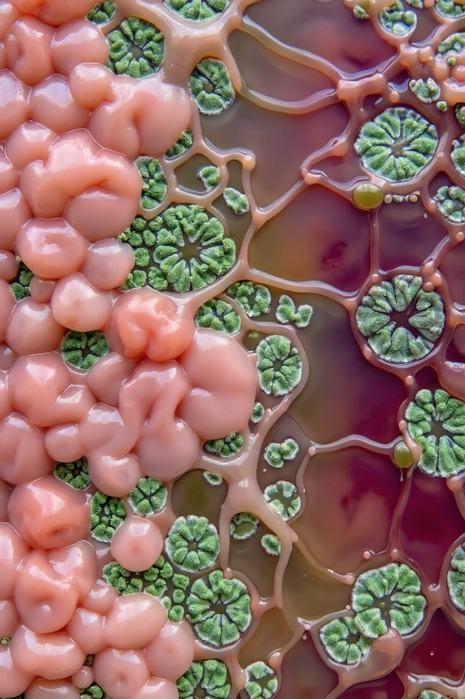
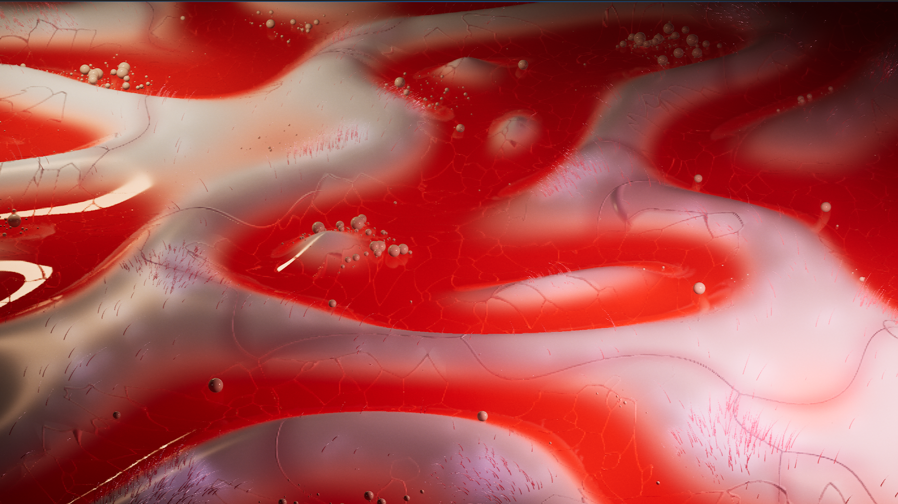
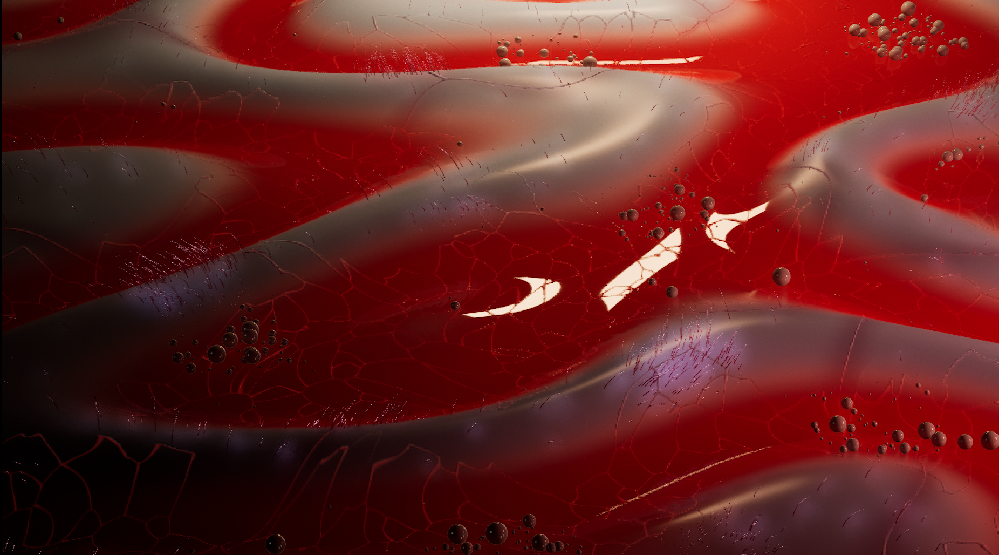
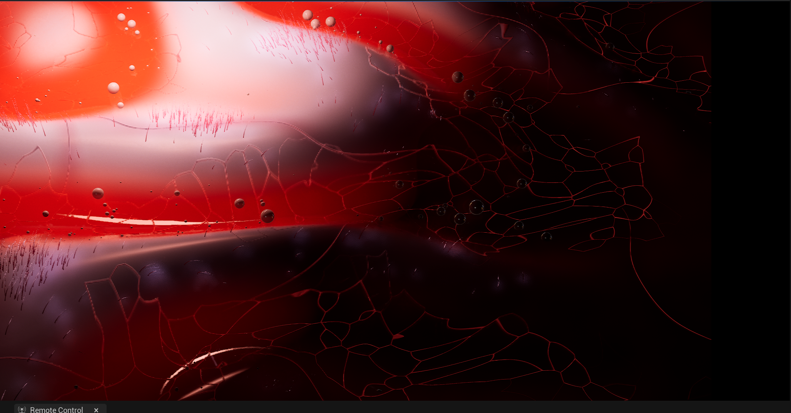

**Procedural Generation and Simulation**  

Prof. Dr. Lena Gieseke \| l.gieseke@filmuniversitaet.de  

---

# Session 05

## Final Project - 80 Points

### Summary
### Concept

---

## Implementation

### *1. TouchDesigner → Unreal Engine: Audio-reactive light control via OSC – 8h*

I connected TouchDesigner to Unreal Engine via OSC so that audio analysis values (bass, highs, kick) control the intensity of three lights in real time through Remote Control.

**Problems**

* Unreal Engine 5 received no OSC signals from TouchDesigner; the REC learn test returned `None`.

**Solution**

1. The signal was blocked on `127.0.0.1` (localhost), and the OSC Data Format was set to `Time Slice` instead of `Sample`. Switched the IP to the IPv4 address (`192.168.178.131`), the port to `9000` and the Data Format to `Sample`.
2. All three TouchDesigner channels were internally named `low`, so they sent identical `/low` addresses. Renamed the channels to `low`, `high` and `kick` to generate distinct OSC paths (`/low`, `/high`, `/kick`).

### *2. Concept refinement & Unreal Engine bridge for material parameters – 6h*

I refined my concept after seeing some mood images of abstract organic macro surfaces on pinterest, inspired by microscopic tissue. Its shape is defined by a mathematical function, Voronoi veins run through it, and every kick acts as a heartbeat that sends a pulse of light through the veins.

On the technical side, I built the bridge between my existing OSC setup and the materials. I created a Material Parameter Collection (`MPC_Organism`) as a central place for all values and a Blueprint (`BP_Organism`) whose variables receive the OSC values via Remote Control. Every frame, the Blueprint writes them into the collection. It also detects each new kick (rising edge) and stores its timestamp as `PulseStart`, which the materials will later use to animate the heartbeat pulse.

<table>
  <tr>
    <td align="center"></td>
    <td align="center"></td>
    <td align="center"></td>
  </tr>
</table>

### *3. Material Functions & live control of the function parameters – 5h*

Next was building the mathematical core of the scene as reusable Material Functions in Unreal Engine. `MF_Field` calculates the height of the organic surface from three blended functions (crossed sine waves, a five-petal polar "flower" and ring waves), including domain warping and a soft fade towards the edges. `MF_FieldNormal` derives the surface normals from the field, so the lighting follows the deformation. `MF_Mask` creates a soft circular region mask that later limits where the veins appear.

I also added a shared clock (`Now`), which the Blueprint writes into the Material Parameter Collection every frame, so that materials and particles stay in sync with the heartbeat. Finally, I set up live control: a Constant CHOP in TouchDesigner sends the function parameters (`freq`, `amp`, `warp`, `funcblend`) via OSC, Remote Control maps them from 0–1 to their actual ranges, and `BP_Organism` passes them on to `MPC_Organism`.

### *4. Organic surface with live deformation – 3h*

I created a subdivided plane (2000 × 2000 units, 256 × 256 subdivisions) in Unreal's Modeling Mode and built the material `M_Surface` for it. The material uses the Subsurface shading model for a soft, skin-like look. It deforms the plane with World Position Offset based on `MF_Field` and gets its lighting from the normals of `MF_FieldNormal`. The surface now moves in real time and can be reshaped live with the sliders in TouchDesigner (frequency, amplitude, warp and blending between the three functions).

**Problems**

1. The valleys of the surface appeared black with flickering, hard edges.
2. In Play mode the surface was completely flat, although it was deformed in the editor.

**Solution**

1. Everything below the original height of the plane was darkened: first the default level floor cut through the valleys, then Lumen still treated the area below the flat plane as "inside" the mesh, because its software ray tracing does not support World Position Offset. Deleted the default `Floor` and lifted the whole surface by `Amp` (`MF_Field` + `Amp`), so the valleys never sink below the original height.
2. The range mapping in Remote Control (0–1 → 0–100) did not convert the values, so `Amp` arrived as 0.4 instead of 40. Removed the Remote Control ranges and scaled the values in `BP_Organism` with Multiply nodes instead (`Freq` × 5, `Amp` × 100, `Warp` × 2, `FuncBlend` × 2).

### *5. Voronoi veins with growth and heartbeat pulse – 9h*

I generated an organic vein network directly in the surface material using a Voronoi algorithm in a Custom HLSL node (`MF_Voronoi`). The cell edges form the veins, a finer second Voronoi layer adds capillaries, and domain warping makes the cells look grown rather than geometric. The veins are colored, slightly raised from the skin, and limited to a circular zone by `MF_Mask`.

The heart of the step is `MF_Pulse`: on every kick, the Blueprint stores the current time as `PulseStart`, and the material sends a ring of light from the heart outwards through the network, cell by cell, fading over time. A `Growth` parameter lets the network grow outwards from the heart. Two hearts alternate on every kick (`UseA` toggle in `BP_Organism`), so the waves overlap and the rhythm feels more alive. To make the veins look truly raised, I added a bump-mapping Custom node (`VeinBump`) that bends the surface normals along the veins, so they catch light and cast shading.

**Problems**

1. After reopening the project, `Amp` could no longer be controlled from TouchDesigner, although all other sliders still worked.
2. The veins looked flat, even with a higher `VeinHeight`.

**Solution**

1. The Remote Control preset contained two OSC bindings for `Amp` that blocked each other. Deleted the duplicate binding and saved the preset separately.
2. The lighting only used the normals of the large field, and the mesh (256 × 256 subdivisions) was too coarse to displace such thin lines geometrically. Added the vein height to the normals with a bump-mapping Custom node (screen-space derivatives of the vein height), so the veins get their own highlights and shadows.

### *6. Pearls in Niagara with forces and heartbeat push – 5h*

I created a GPU particle system (`NS_Pearls`) that places around 3,000 pearl-like spheres on the organic surface. Each pearl remembers its starting position (`RestPos`) when it spawns. All movement happens in a single Scratch Pad module with a Custom HLSL node written by Claude: it evaluates the same field function as the surface material, so every pearl sits exactly on the moving skin. A spring pulls the pearls back to their rest position, drag calms the motion, and pearls are only visible in the valleys of the surface. On every kick, the heartbeat wave pushes the pearls away from the heart and makes them swell briefly, perfectly in sync with the light pulse in the veins. The values come from the shared `MPC_Organism` via a Niagara Parameter Collection (`NPC_Organism`). The pearls use a clear-coat material with a Fresnel-based shimmer from pink to green, similar to mother-of-pearl, and cast shadows onto the skin.

### *7. Organic Voronoi and Two Material Zones – Xh*

The vein net now reacts to the function's height. Dense small cells sit in the valleys and merge into a few large cells on the hills, so a large cell borders many small ones. This is done with two Voronoi networks (fine + coarse) in one Custom HLSL node. Each fine cell merges based on the height at its centre, and its walls fade out once both neighbours have merged. The coarse network only shows where cells have merged. The material was split into dark red valleys and light blue hills, joined by a long, soft gradient with a red halo along the large veins. The pearls are now pushed by both hearts. I then let the ~140-node material graph rebuilt by claude as copy-paste text (Unreal's T3D format), grouped into labelled comment boxes with adjustable Constants and colour pickers. This kept the graph readable and made it much faster to try out different visual options.

**Problems**
1. Blending three Voronoi layers, and later a weighted single Voronoi, produced broken veins, straight seams, sliver cells and hectic motion.
2. Fading veins by height created a visible straight boundary between red and light, with dangling vein ends.
3. Shader compile errors ("DerivCoarseX not valid in shader model vs_6_6", "return float2 p = …").
4. Patchy colours and jagged edges in the red–blue gradient.

**Solution**
1. and 2. Separate layers can't connect, distance weights let far-away cells leak into pixels, and fading only hid veins instead of changing the network. Replaced all of this with two plain, unweighted Voronoi networks and a per-cell merge value: walls thin out and fade, so every visible wall stays closed.
3. `ddx`/`ddy` don't exist in the vertex shader that computes World Position Offset, and quotation marks in a code comment cut off the pasted code. Removed both.
4. Per-cell values jumped at invisible walls and red→blue blending passed through purple. Switched to a single light blue, averaged cell states smoothly, limited the halo to large veins, and used a three-stop gradient (red → light warm tone → light blue).

### *8. Hairs on the Hills – 4h*

To give the hills a soft, furry texture, I added a second Niagara system (NS_Hair), derived from the pearl system. Thin cone meshes grow only on the hills, gathering in tufts with a few single hairs in between. At rest they curve in a slowly shifting direction like combed fur; high frequencies from TouchDesigner make them straighten up and tremble. A Custom HLSL module in the scratch pad calculates each hair's position, length, orientation and bend, while the material M_Hair performs the curvature via World Position Offset: each ring of the cone rotates slightly further along an arc, preserving the hair's length so the tips can droop. A first attempt that only shifted vertices sideways stretched the hairs instead, so I replaced it with this approach. Finally, a subtle emissive gradient, increasing towards the tip and strongest in the core, gives the hairs depth rather than a flat glow.

**Problems**
1. The bend values calculated in Niagara could not be passed directly to the material.
2. The arc bend requires each hair's actual length, which varies per hair and was not available in the material.

**Solution**
1. As the material's Dynamic Parameter cannot be written to in the Map Set node, I stored the values in custom particle attributes (Particles.BendX, Particles.BendY) and forwarded them with the "Dynamic Material Parameters" module.
2. The material determines the length itself by transforming the cone axis (0, 0, 100) from local to world space and taking the vector's length, which already includes the particle and Mesh Renderer scale.

 

### *9. Hiding the Edges – 1,5h*

So far, the surface ended in a visible straight edge, which broke the illusion of an endless organism. To hide it, I enlarged the plane to 4000 × 4000 units and added an edge mask to M_Surface: starting at a set distance from the centre (FadeStart 1300, FadeEnd 1900), the surface gradually flattens and fades to black, as do its colour, specular, subsurface and emission. Beneath it, a black ground plane continues the darkness, so the organism appears to dissolve into the void. The vein area and growth radius in the Material Parameter Collection were extended to match the new size.

**Problems**
1. The larger surface noticeably increased the rendering cost, even in areas that end up completely black.
2. The pearls and hairs ignored the fading edge: pearls floated above the sunken surface, and hairs kept growing in the black area.

**Solution**
1. Hiding the edge with fog would not have reduced the cost, as everything behind it is still calculated. Instead, the Voronoi calculation stops early outside the edge mask, and I kept the plane's resolution moderate (512 subdivisions).
2. I added the same mask with identical values to both Niagara modules, so the pearls sink together with the surface and the hairs shrink to nothing towards the edge.

### *10. Lighting, Look and Camera – 7h*

In the final step, I refined the overall atmosphere of the scene. The valleys now appear wet and slimy through very low roughness, high specular and a stronger red subsurface scattering with reduced opacity, while the bright shells received a slightly rougher, waxy finish. The pearls were corrected so that they rest on the surface instead of floating above it. For the lighting, I combined Rect Lights with an exponential height fog to create depth, and used bloom to make the pulsing veins glow beyond their edges. Beyond the planned changes, the hairs now also light up in response to high frequencies. Instead of an animated camera, I built a free-flying camera that keeps the cinematic depth of field, allowing me to move through the organism live.

**Problems**
1. The Sky Light made the edges of the black ground visible, and it cannot be restricted to individual objects.
2. In the fog, the light sources appeared as bright, clearly visible spots.
3. The default play camera offered neither depth of field nor the ability to look around freely with a cinematic lens.
4. The high-frequency value had to reach the hair material per particle, but the dynamic parameters were already in use and unreliable.

**Solution**
1. I made the ground material unlit, so it ignores all light, and turned off the Sky Light entirely. To keep the studio reflections on the pearls, I sample the HDRI directly in their material using the reflection vector and a Fresnel mask.
2. Each light's Volumetric Scattering Intensity was set to zero, which removes its presence in the fog without changing how it illuminates the surface.
3. I created a custom pawn based on the DefaultPawn with an attached CineCamera and set it as the default pawn via a game mode. Enabling "Use Pawn Control Rotation" lets the camera follow the mouse in all directions.
4. The value is written into the particle colour in Niagara, which the material reliably reads through the Particle Color node and uses to scale the existing emissive gradient.

### Resources:

#### Step 1:
- [YouTube Tutorial by Nils Gallist – TouchISC x Unreal Engine 5 ](https://www.youtube.com/watch?v=YjEBCUAO7ec)
- [YouTube Tutorial by The interactive & Immersive HG – Controlling Lights in Unreal Engine via OSC from TouchDesigner](https://www.youtube.com/watch?v=PQAeUkcykVo&list=PLpuCjVEMQha_EVqrQeiuCi5HGBbtsrkJk)
- [Bug fixing Gemini](https://gemini.google.com/app)
- [Bug fixing and guiding with Claude](https://claude.ai/new)

#### Step 2:
- [Bug fixing and guiding with Claude](https://claude.ai/new)
- [Unreal Engine Docs – Using Material Parameter Collections](https://dev.epicgames.com/documentation/unreal-engine/using-material-parameter-collections-in-unreal-engine)
- [Unreal Engine Docs – Blueprint Variables](https://dev.epicgames.com/documentation/en-us/unreal-engine/blueprint-variables-in-unreal-engine)
- [Unreal Engine Docs – Flow Control (Branch, Sequence)](https://dev.epicgames.com/documentation/en-us/unreal-engine/flow-control-in-unreal-engine)
- [Unreal Engine Docs – Getting Started with Remote Control Presets](https://dev.epicgames.com/documentation/en-us/unreal-engine/getting-started-with-remote-control-presets-in-unreal-engine)

#### Step 3:
- [Bug fixing and guiding with Claude](https://claude.ai/new)
- [Unreal Engine Docs – Material Functions](https://dev.epicgames.com/documentation/en-us/unreal-engine/material-functions-in-unreal-engine)
- [Unreal Engine Docs – Custom Material Expressions (HLSL)](https://dev.epicgames.com/documentation/en-us/unreal-engine/custom-material-expressions-in-unreal-engine)
- [Unreal Engine Docs – Using Material Parameter Collections](https://dev.epicgames.com/documentation/unreal-engine/using-material-parameter-collections-in-unreal-engine)
- [Unreal Engine Docs – Material Parameter Expressions (Collection Parameter)](https://dev.epicgames.com/documentation/en-us/unreal-engine/material-parameter-expressions-in-unreal-engine)
- [Unreal Engine Docs – Remote Control Protocols (OSC)](https://dev.epicgames.com/documentation/unreal-engine/remote-control-protocols-in-unreal-engine?lang=en-US)
- [TouchDesigner Docs – Constant CHOP](https://derivative.ca/UserGuide/Constant_CHOP)
- [TouchDesigner Docs – OSC Out CHOP](https://derivative.ca/UserGuide/OSC_Out_CHOP)
- [The Book of Shaders – Cellular Noise (Voronoi)](https://thebookofshaders.com/12/)
- [Concept development and step-by-step guide with Claude](https://claude.ai/new)

#### Step 4
- [Unreal Engine Docs – Modeling Mode](https://dev.epicgames.com/documentation/en-us/unreal-engine/modeling-mode-in-unreal-engine)
- [Unreal Engine Docs – Material Inputs (World Position Offset, Normal)](https://dev.epicgames.com/documentation/en-us/unreal-engine/material-inputs-in-unreal-engine)
- [Unreal Engine Docs – Subsurface Shading Model](https://dev.epicgames.com/documentation/en-us/unreal-engine/subsurface-shading-model-in-unreal-engine)
- [Unreal Engine Docs – Lumen Technical Details](https://dev.epicgames.com/documentation/en-us/unreal-engine/lumen-technical-details-in-unreal-engine)
- [Bug fixing and guiding with Claude](https://claude.ai/new)

#### Step 5
- [The Book of Shaders – Cellular Noise (Voronoi)](https://thebookofshaders.com/12/)
- [Bug fixing and guiding with Claude](https://claude.ai/new)
- [Unreal Engine Docs – Custom Material Expressions (HLSL)](https://dev.epicgames.com/documentation/en-us/unreal-engine/custom-material-expressions-in-unreal-engine)
- [Unreal Engine Docs – Organizing a Material Graph (Named Reroutes)](https://dev.epicgames.com/documentation/en-us/unreal-engine/organizing-a-material-graph-in-unreal-engine)
- [Morten S. Mikkelsen – Bump Mapping Unparametrized Surfaces on the GPU](https://hgpu.org/?p=3263)

#### Step 6

- [Unreal Engine Docs – Niagara Scratch Pad Modules](https://dev.epicgames.com/documentation/en-us/unreal-engine/niagara-scratch-pad-modules-in-unreal-engine)
- [Unreal Engine Docs – Render Module Reference for Niagara (Mesh Renderer)](https://dev.epicgames.com/documentation/en-us/unreal-engine/render-module-reference-for-niagara-effects-in-unreal-engine)
- [Unreal Engine API – Niagara Parameter Collection](https://dev.epicgames.com/documentation/unreal-engine/API/Plugins/Niagara/UNiagaraParameterCollection)

#### Step 7
- [Bug fixing, guiding and rebuilt of node network with Claude](https://claude.ai/new)
- [Custom Material Expressions in Unreal Engine (Epic Games)](https://dev.epicgames.com/documentation/en-us/unreal-engine/custom-material-expressions-in-unreal-engine)
- [Material Attributes Expressions (Epic Games)](https://dev.epicgames.com/documentation/en-us/unreal-engine/material-attributes-expressions-in-unreal-engine)
- [Inigo Quilez – Voronoi Edges](https://iquilezles.org/articles/voronoilines/)

#### Step 7
- [Bug fixing and guiding with Claude](https://claude.ai/new)

#### Step 8
- [Bug fixing and guiding with Claude](https://claude.ai/new)

#### Step 9
- [Bug fixing and guiding with Claude](https://claude.ai/new)

### Results
### Project Reflection & Discussion
### Lessons Learned

## Wrap-Up - 3 Points

### Task 05.02 - Feedback

Please answer the following questions briefly so that I can further improve the lecture for future students.

* How would you rate the difficulty of this lecture from 1 (far too easy) to 5 (far too difficult)?
* How would you rate the amount of work you had to put into this lecture so far from 1 (no work at all) to 5 (far too much work)?
* How well did the given time estimates for each session match the time you needed to complete the session?
* What do you think about Unreal as tool to learn for a CTecht & VFX student? Is it valuable?
* What do you think about Unreal as a tool for this class? 
* Do you have any other ideas reading which tools and software packages to use for this class?
* Do you have any useful hints to pass on to future students, e.g. utility tools, or further resources?
* What is your opinion regarding practical exercises in class? Did they fit? Did you enjoy working o
* How did the practical exercises fit the theoretical topics of the class? 
* Did you enjoy working on the practical exercises? If not, why not? 
* Do you think the practical exercises where beneficial for your learning?
* Which one was your favorite chapter, and which one was your least favorite?
* Was there a topic missing and if so which one?
* Are there any other artists that would fit to the class content and that would be worthwhile to discuss in class?
* Please feel free to add any feedback you want to give!

For VFX only:
* How suitable do you rate this class overall for VFX students?
* What can be changed or improved to make the class fit to VFX students' needs?

*Submission*: Answer in your submission file.  

## Learnings - 10 Points

### Task 05.03.01

Summarize your learnings within the course in whole sentences. What was challenging for you during this course? How did you challenge yourself?

*Submission*: Answer in your submission file.  

### Task 05.03.02

To make the best possible use of the lecture, please reflect on the following questions.

Does it make sense for you

* ...to have procedural generation in your set of skills? If yes, 
    * with which tool do you want to work with?
    * which outputs / designs / setups are you aiming for?
* ...to have Unreal in your set of skills? If yes, 
    * which Unreal topic so you want to look into next?
    * which outputs / designs / setups are you aiming for?

Describe your next steps within the lecture topics depending on your answers.

*Submission*: Answer in your file.  

---
## How To Submit

### CTech

Answer all questions directly in a copy of this file and **also link and display all of your images in that file**. Submit your copy as `pgs_XX_lastname.md` in your submissions folder (replace the XX with the number of the session). 

Please add `nav_exclude: true` to the header of your submission file so that it is not added to the navigation bar of the overall website.

### VFX

To hand in your homework assignment, you submit images and texts in your OwnCloud document:

* [The OwnCloud Folder](https://owncloud.gwdg.de/index.php/s/CSVXtrxMNDyER3T)
* Open your file, add your text, links, etc.
  

---

That's it. It was a pleasure!

  
[[pinterest]](https://id.pinterest.com/pin/290271138471721193/)

---

**Happy Finalizing!**
