**Procedural Generation and Simulation**  

Prof. Dr. Lena Gieseke \| l.gieseke@filmuniversitaet.de  

---

# Session 05

* [Homework](#homework)
* [Final Project - 80 Points](#final-project---80-points)
    * [Task 05.01 - Free](#task-0501---free)
* [Wrap-Up - 3 Points](#wrap-up---3-points)
    * [Task 05.02 - Feedback](#task-0502---feedback)
* [Learnings - 10 Points](#learnings---10-points)
    * [Task 05.03.01](#task-050301)
    * [Task 05.03.02](#task-050302)
* [How To Submit](#how-to-submit)
    * [CTech](#ctech)
    * [VFX](#vfx)

## Homework

Complete and optimize all homework assignments by July 31th. Submissions after that date will no be considered.

*Submission:* Update or add to your existing submission folder / file.

## Final Project - 80 Points

### Task 05.01 - Free 

# No place like here

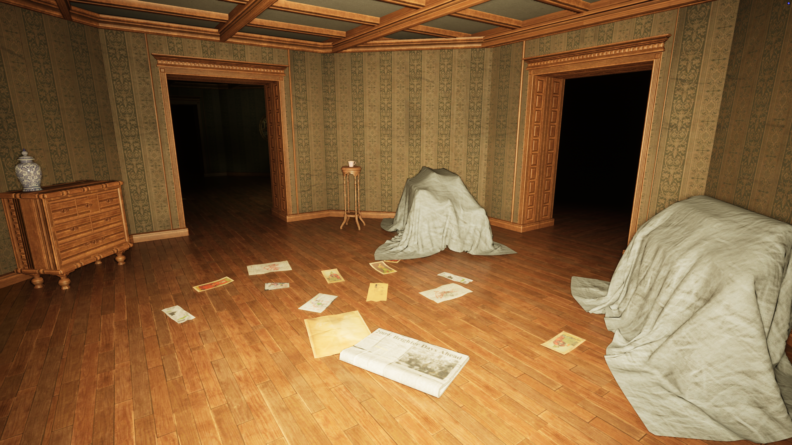

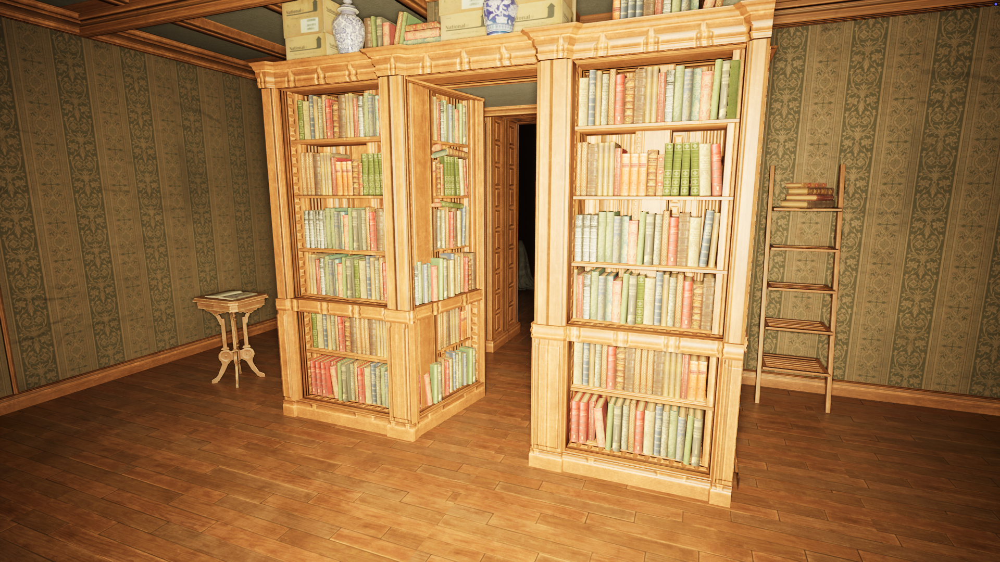

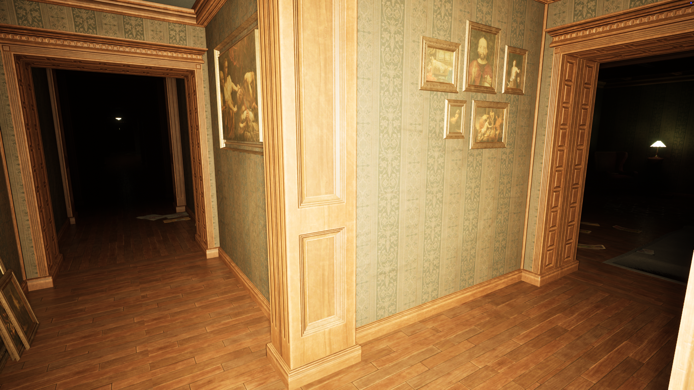

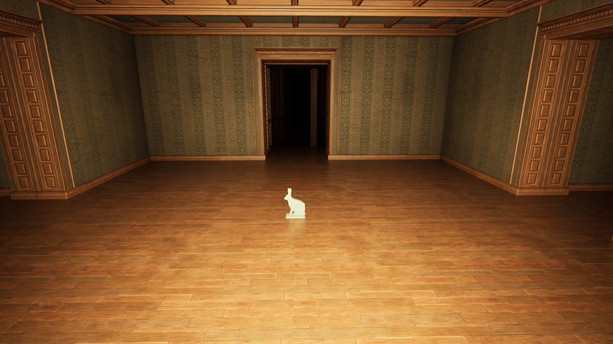

[Video Link](https://owncloud.gwdg.de/index.php/s/MhuTiz9evsMMXPf)

## Summary
“No place like here” is an Unreal experience in which you wander through an every repeating and changing maze of rooms and corridors. It is created with procedurally repeating and changing rooms which build an infinite maze to put viewers in a sense of unease and the inevitable realization that there is no escape. The technical implementation focuses on noise, tiling and grid systems in Unreal Blueprints and PCG. 

I had the idea for an ever changing and ever repeating construction of rooms based on the Library of Babel short story by Jorge Luis Borges. In this story there is an infinite library of the same repeating hexagonal room filled with books. These books are filled with randomly assorted characters, but the basis of this place being infinity makes it so every book that has ever been written or will be is contained within it. Instead of generating every book ever or recreating the library I wanted to mix it with my interest in liminal spaces. 
In my research for this project I also found someone who had already created the library: https://keiwan.itch.io/library-of-babel-3d

I have been fascinated by the concept of a space being dreadful in itself and having a mind of its own, as in House of Leaves or the Backrooms. With these inspirations I wanted to create a procedurally generated network of rooms that confuse through repetition and give viewers an experience of dread. 

### Naming
The title “No place like here”  should invoke a false feeling of welcomeness, so when read, it should be inviting and bring up comparisons to the phrase “No place like home”. But when experienced it should become more and more obvious that the viewer is trapped in a place which does not let you leave. So there literally is no other place than where they are right now. 

## Implementation
I structured my project to start with what I didn't understand yet and to build upon that with things I am already familiar with. So I would first need to get a grid of rooms, then set them to vary, then populate the environment and finally make adjustments to visuals.

I started with the Unreal FPS preset, because a first person perspective draws users in more and makes them identify as the player. I then worked with multiple tutorials by [Procedural Minds](https://www.youtube.com/@Procedural_Minds) , deciding I was going to mainly use Unreal's PCG graph editor instead of Blueprints. They function similarly but the PCG systems were more fitting to my goal. 

I created a system in the PCG Graph (/Game/PCG/PCG_Maze), which creates an adjustable point grid that can load and unload. Through random noise the directions of those points are shuffled by increments of 90 degrees. Then I connected that to spawn cubes in that grid. 

After I got that working I needed to model the room in unreal so I could adjust all the settings in my PCG graph accordingly. 

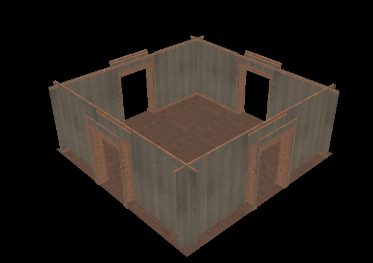

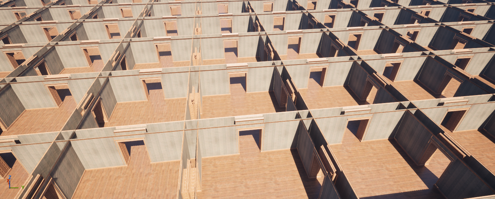

I then went on to create 3 different room shapes and integrate them into the PCG system. The integration proved hard because I hadn’t considered variation in the initial spawning logic, resulting in a maze consisting exclusively of either Room A or Room B. After looking through multiple online tutorials, I figured out that I would need to create a nested PCG Subgraph within my current PCG system. This subgraph utilizes a parameter array to randomly select and spawn individual room variants per grid point. Here my approach of doing the hardest thing first and then integrating later features really stung me, because I had to rework the spawing system. 

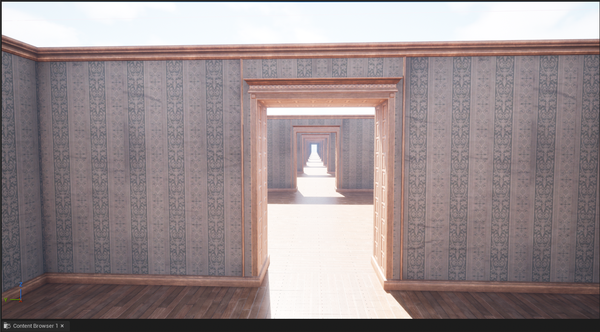

I tried to populate the environment with a Blueprint inside my room models but after a lot of ideation I was not really happy with the results. I used the results to create my own room models and used the logic in another PCG system which populates each room with scattered paper documents. 

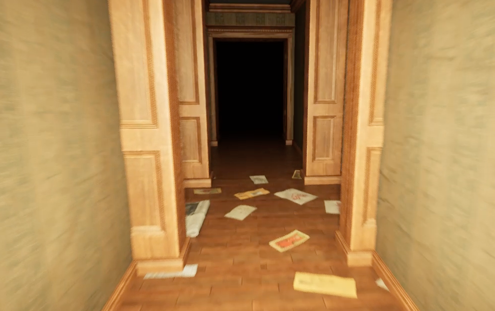

This works by finding points in the mesh from the PCG room system that are perfectly horizontal and putting points there. Then I positioned clusters of points around those so it doesn't look like a random assortment of paper everywhere but rather singular clusters at some points. Here I was already able to apply what I learned previously regarding spawning, random rotation and mesh arrays. 

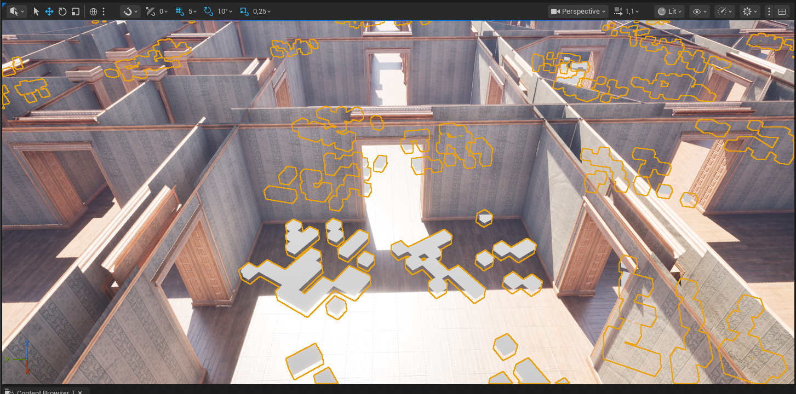

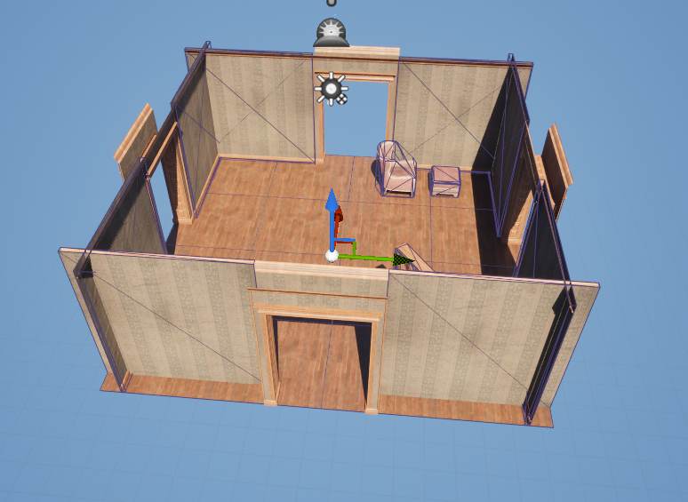

Even though the environment is infinitely scalable, I noticed that I should include an option to reduce the scale for less performant computers. I added bookshelves to dynamically cap the ends of the PCG volume. 

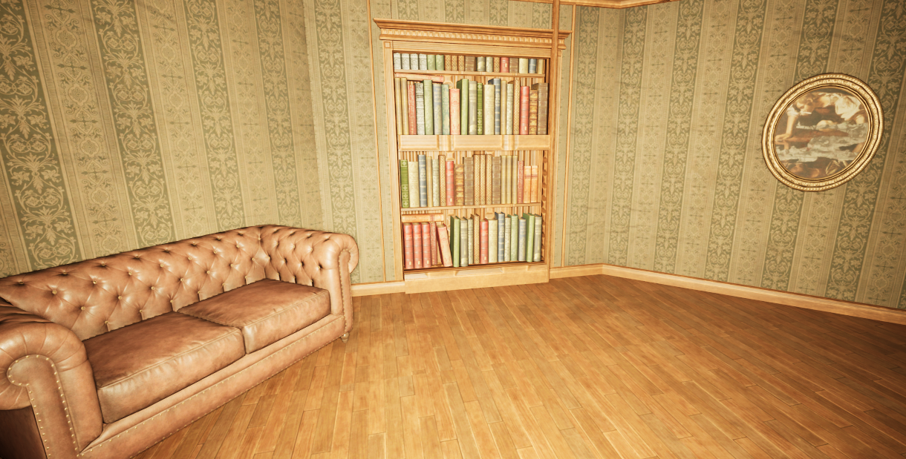

In the end, I took the time to remove the FPS character's arms, change the movement speed, add a light to the character, draw an icon and loading screen, and adjust various other settings.

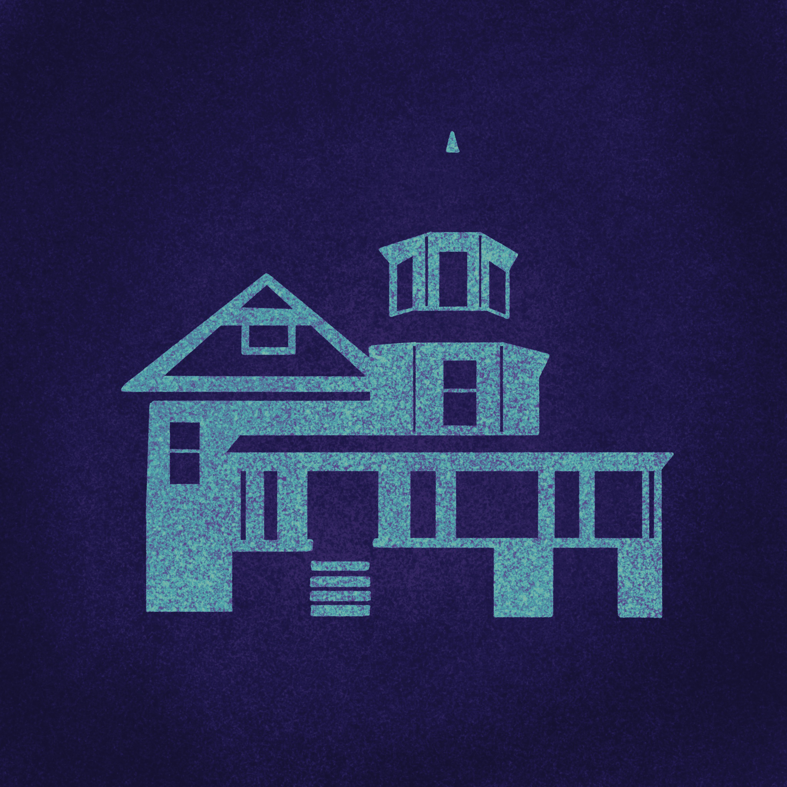

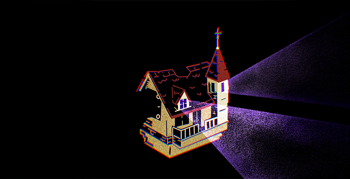

---

[Folder with all large files](https://owncloud.gwdg.de/index.php/s/tgCt4GXyhypIFNz)

*Here is also a video of some of the in-between steps*

## Reflection 

I really enjoyed working on this project and I have come back to it a bunch of times even  after reaching my 40 hour goal to play around with more settings and adding just a bit more there and a bit more here. I learned a whole lot through this project and am really fascinated by Unreal. Before this project and this course I always thought my Unity experience would be why I would never work with unreal but now I understand in which ways they are different tools for different tasks. I learned to use PCG systems and became more confident in my work with blueprints. 
I really hope I can use this project as a basis for something else. Now that I have the environment, I want to do more than just walk around in it. This has really become a passion project and I don’t want it to end here. 

## Challenges

I should have planned more beforehand because a lot of my struggles came from the project being step by step. This of course happened because I didn’t know that much to begin with but some of my struggles could have been avoided earlier. 

The approach to do the hard stuff in the beginning is good if you are not quite sure in which direction the project will develop. But I put a lot of “simple” stuff off and I did not plan my time accordingly. Just because the room creation is hard doesn’t mean you can add and adjust a light in a minute. The last tasks piled up a bit. 

## Learnings

### General
I learned how to create PCG systems in unreal, furthered my knowledge of blueprints. I can now understand which part in my system does what and can adjust them and add new features. 

### Abandon and Repurpose
I tried creating the interior of the rooms with point markers and arrays of possible meshes to fill those. This would have made each interior procedurally different in each room. That took away from the concept of repetition and confusion I liked. It also never really looked as good as I might have hoped. 
So I scrapped using the procedural room interior for my final version and used it as an inbetween step. I generated rooms, changed the seed and then adjusted objects, added, removed and replaced. I then added those polished rooms into the generator. This gave a random approach to the interior with ideas I would have never thought of and gave me the ability to include rooms I really wanted to have in there. One example of a new idea was when I randomly generated a hallway in which 3 of the paintings were of Ivan the Terrible and because I thought this peculiar coincidence had charm I changed it so all 8 were of Ivan. 

### Concept over Approach
I have noticed that in past projects I focused on what I could do and what tutorials I can find and build my ideas after. That always led to good and functioning results. But in this project I started with a concept and no idea how I would approach it. This led me to way bigger learnings in Unreal which is a software I have never used before this class. Now after I am done, I feel confident enough to use Unreal as a tool in later projects. 

## Wrap-Up - 3 Points

### Task 05.02 - Feedback

Please answer the following questions briefly so that I can further improve the lecture for future students.

* How would you rate the difficulty of this lecture from 1 (far too easy) to 5 (far too difficult)?  
3/5 Difficult but scalable to one's own skillset. The homework doesn't punish not understanding parts of the lecture. 
---
* How would you rate the amount of work you had to put into this lecture so far from 1 (no work at all) to 5 (far too much work)?  
3.5/5 Not more than the course should require but coming with no experience in the subjects it was quite a lot. 
---
* How well did the given time estimates for each session match the time you needed to complete the session?  
I think the time estimations are pretty accurate and it’s by my own making that I overreach them. I think 3 and 4 might be 2 hours more. 
---
* What do you think about Unreal as tool to learn for a CTecht & VFX student? Is it valuable?  
After not having worked with it before I finally understand why so many people in the creative space and in the Creative Technologies direction are so obsessed with it. I probably wouldn't have spent time learning Unreal, because I would have spent that time refining Unity or Blender skills but I am very happy that I did because it has features neither than the other software provides. So it’s a “yes”, it's valuable for Ctech and I think also for VFX. 
---
* What do you think about Unreal as a tool for this class?   
I liked working with it, even if sometimes working alone I sometimes didn't quite understand why we were doing what we were doing. A node based system makes it very fun for beginners to play around with and I think that's what caught me with Unreal. If I didn't know what I was doing in a text based language I would have experimented way less. 

---
* Do you have any other ideas reading which tools and software packages to use for this class?  
Of course I am going to write the obligatory Blender Geometry Node system because I have a bit more experience with it and I think being integrated in Blender might give more opportunity to use learned skills in future projects. 
---
* Do you have any useful hints to pass on to future students, e.g. utility tools, or further resources?  
Not particularly. Just your tutorial recommendations. 

---
* What is your opinion regarding practical exercises in class? Did they fit? Did you enjoy working on?  
I liked the particle exercises and I thought they were fitting for the class. 
I think the particle exercise fits in with the theoretical aspects of the lecture. It worked of course with the theoretical math we had been talking about. Real application of forces and noise as well as practical uses of math in the material and color change.
---
* How did the practical exercises fit the theoretical topics of the class?  
I think the theoretical explanation always gave an overview with an in-depth explanation of the basics and the practical exercise took a slice of what we learned and then integrated that into a project. 
---
* Did you enjoy working on the practical exercises? If not, why not?  
Yes (Further explanation in the next answer).  
For some reason I had problems with the dancing cube exercise. I messed up a lot and made mistakes from the tutorial and it took me way longer. I can not say why, it’s not the fault of the documentation but for some reason I struggled with that. Whenever I found my mistake, I looked in the documentation and there it was correct. I really can not say why.
---
* Do you think the practical exercises where beneficial for your learning?  
I enjoyed working with practical exercises. One aspect is of course going out of the class with something felt better than just leaving with “More knowledge than you had before” (just a better feeling). The other thing I noticed while working on assignments is: I remember what we did in the projects way better than what was explained in class. I can remember the change to a node and how that affected the model/material/blueprint way better than the knowledge written on a particular slide. I don’t want to say: I don’t remember the theoretical lesions. My capability of recalling an aspect of the work is better when it is applied to one of the exercises. 
---
* Which one was your favorite chapter, and which one was your least favorite?  
I think I was a fan of “Beauty in Maths” to an annoying amount but I just always enjoyed that subject and I felt it was well done and covered a lot of my favorite aspects.  
“Noise” was also good and I felt like I learned a lot I can apply in my future projects.  
I think “Function Design” wasn’t a bad chapter, I just felt it was very hard to comprehend everything in the tim we had. 

---
* Was there a topic missing and if so which one?  
I read through the “Tilings and the Universe” and thought that was quite cool and I’m sad we didn’t get to it in class. 
---
* Are there any other artists that would fit to the class content and that would be worthwhile to discuss in class?  
It doesn't “fit” directly but I am always amazed at the procedural materials by Rahul Parihar with the online alias doublegum_. His stylized materials always catch my attention when I see them.  
Instagram Link: https://www.instagram.com/doublegum_/?hl=de  
And of course Hamid Naderi Yeganeh who creates stunning images only through mathematical equations.  
Twitter Link: https://x.com/naderi_yeganeh

---
* Please feel free to add any feedback you want to give!  
I very much enjoyed the class and wanted to give positive feedback that even when some of the theoretical material is very dry or hard to comprehend it’s good that we don't necessarily have to understand them to their entirety to complete our tasks. In this sense everyone can learn at their own pace and take away what's new for them without being left behind. 

---
*Submission*: Answer in your submission file.  

## Learnings - 10 Points

### Task 05.03.01

Summarize your learnings within the course in whole sentences. What was challenging for you during this course? How did you challenge yourself?

*Submission*: 
My biggest learning of course was the basics in Unreal. I came with the experience of Unity regarding file management and scene setups but it was still a huge difference going from one to the other. So a big takeaway would be that I would be comfortable to use Unreal for projects in the future.  
I would say that I have also not previously worked on abstract visuals in 3D. I haven't worked with just patterns, shapes, materials. Working with 3D in the past (excluding TouchDesigner) I always had private or work projects in which I aimed or had to aim for a realistic or slightly stylised real world environment. So it was very new for me to go into a 3D simulation, generation, motion graphics direction.  
Working with particle systems was not new to me but customizing them in the way we did was. Previously I only played around with the parameters given but didn’t include my own geometry and the custom changes, variations and possibilities. My new understanding of the possibilities of particle systems makes me want to go back to my First Term project and rework the visuals. :)   
Another more conceptual takeaway was working in a way where I leave my concepts open for change in the future. What I mean by that is that for example when I want a 1 to 10 ratio in my cube and sphere spawning system. I don’t enter 100 instances in my cubes as a value and 1000 in my sphere spawning system. I would rather isolate those values, connect variables to both and influence that variable with the values for total amount and ratio. That might not seem like a huge learning but the advantages are a lot. For one it’s easier to see what I actually changed, on another hand it takes less time to iterate and it also gives advantages of how future editions might also be connected to previous systems.  
Even if I didn’t use GLSL shaders for a submission I would still say that working with them was a big learning for me and I want to play around with them in the future. Before the examples shown to us on shadertoy I was not aware of the possibilities one has when working with it. Although reaching the level of Inigo Quilez seems unobtainable for a mortal CTechy like me.  

I tried to challenge myself in the homework by not trying to follow a tutorial directly and changing something or adding something but rather setting out for a goal of what to create and then looking for tutorials and processes accordingly. That was also an aspect I did in previous classes where I just experimented until something looks good and I work from that but this time I tried to go in more with a plan and try to execute on that rather than figuring out what to do by doing. This felt more like a realistic scenario and a learning in how  to reach goals and progression in understanding the software rather than playing around with what I am already comfortable with. 

### Task 05.03.02

To make the best possible use of the lecture, please reflect on the following questions.

Does it make sense for you

* ...to have procedural generation in your set of skills? If yes, 
    * with which tool do you want to work with?  
    I think it makes a lot of sense for me to have procedural generation in my set of skills. I think it's very useful for my 3D work and might also come in handy for XR applications.  
I would like to continue working with Unreal but I am also very interested in working with Blender to see what I can apply from my new learnings to a different software.  

---

* which outputs / designs / setups are you aiming for?  
One thing I would want to aim for is working with procedural generation and seeing that work in VR. Procedural generation lends itself perfectly to gigantic set piece with details no one wants to individually create, so I think that might be a future project I want to tackle with unreal. 
---

* ...to have Unreal in your set of skills? If yes, 
    * which Unreal topic so you want to look into next?
    * which outputs / designs / setups are you aiming for?  
Regarding my previous answer, Unreal's VR capabilities would be something I would want to look into next. Another thing that interests me is people using Unreal to “film” animations inside. In the past I dismissed this because I thought of Unreal as a game engine and that it was a substitute for “an actual” 3D software. Now I feel foolish for thinking that and would want to look into whether creating models in Blender and staging scenes in Unreal might be better in my future projects. 

---

---
## How To Submit

### CTech

Answer all questions directly in a copy of this file and **also link and display all of your images in that file**. Submit your copy as `pgs_XX_lastname.md` in your submissions folder (replace the XX with the number of the session). 

Please add `nav_exclude: true` to the header of your submission file so that it is not added to the navigation bar of the overall website.

### VFX

To hand in your homework assignment, you submit images and texts in your OwnCloud document:

* [The OwnCloud Folder](https://owncloud.gwdg.de/index.php/s/CSVXtrxMNDyER3T)
* Open your file, add your text, links, etc.
  

---

That's it. It was a pleasure!

---

**Happy Finalizing!**