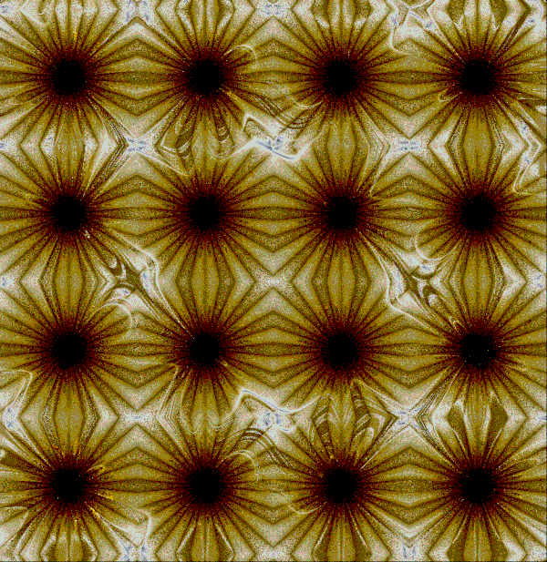
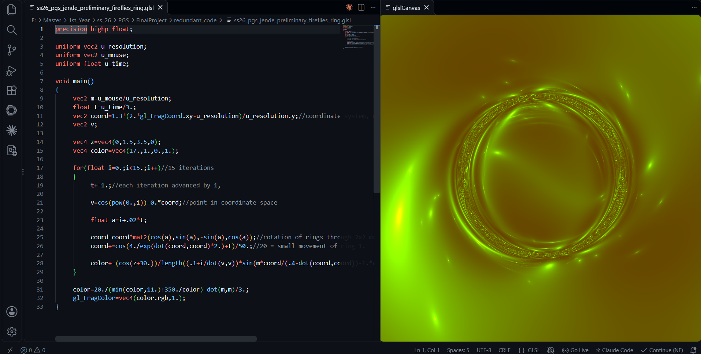
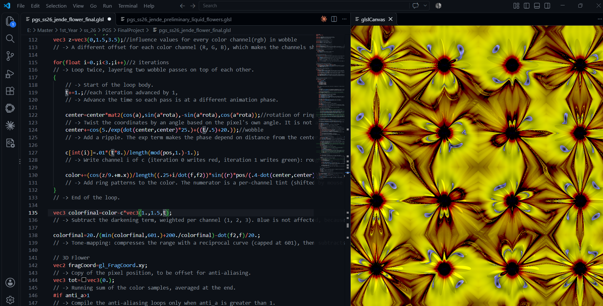
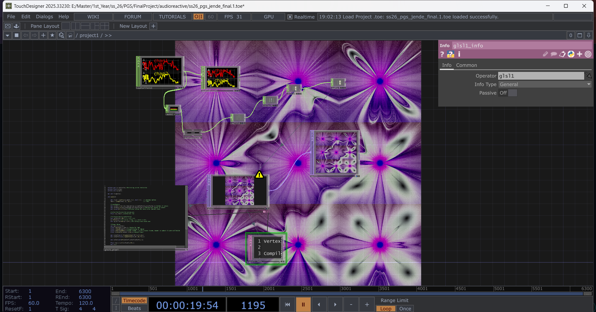
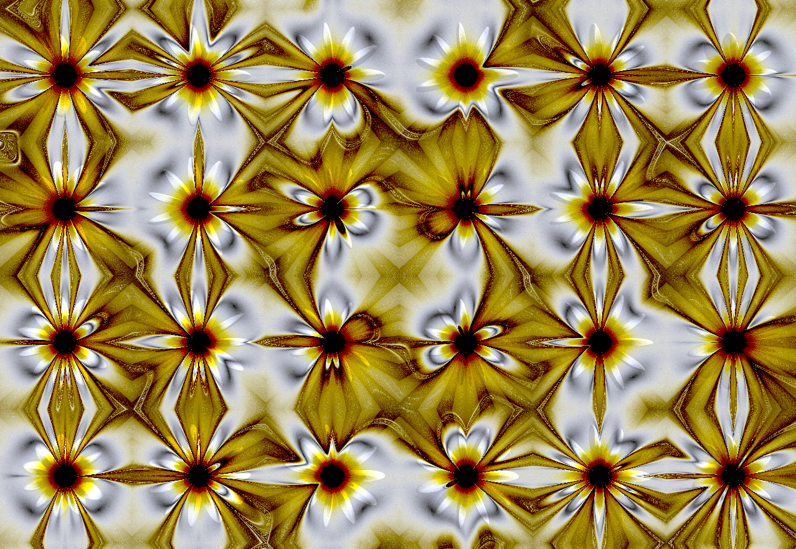
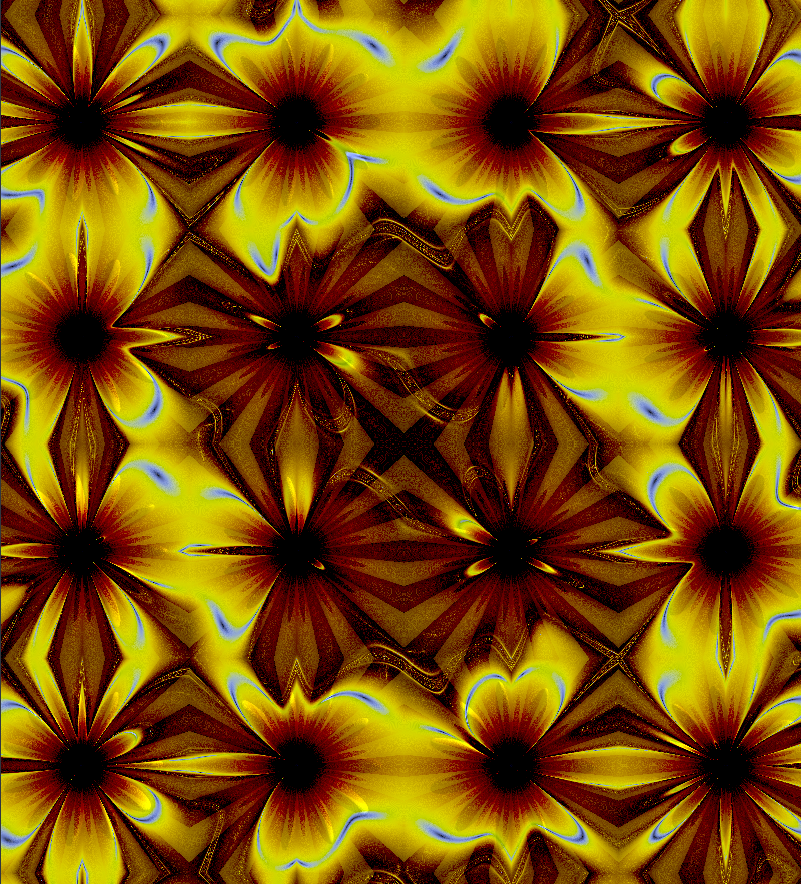
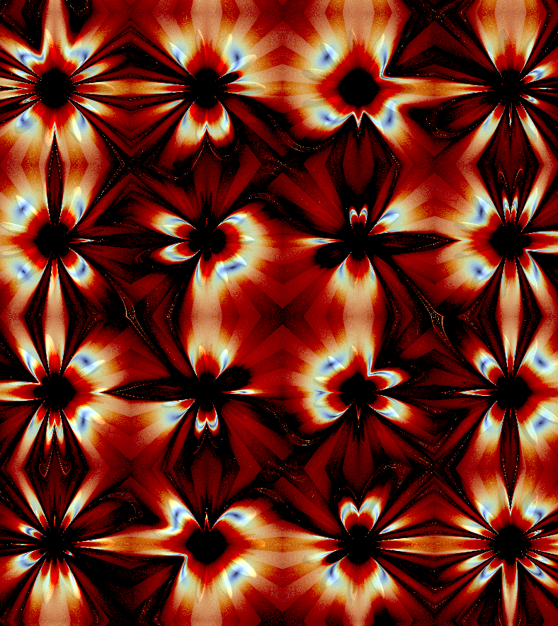
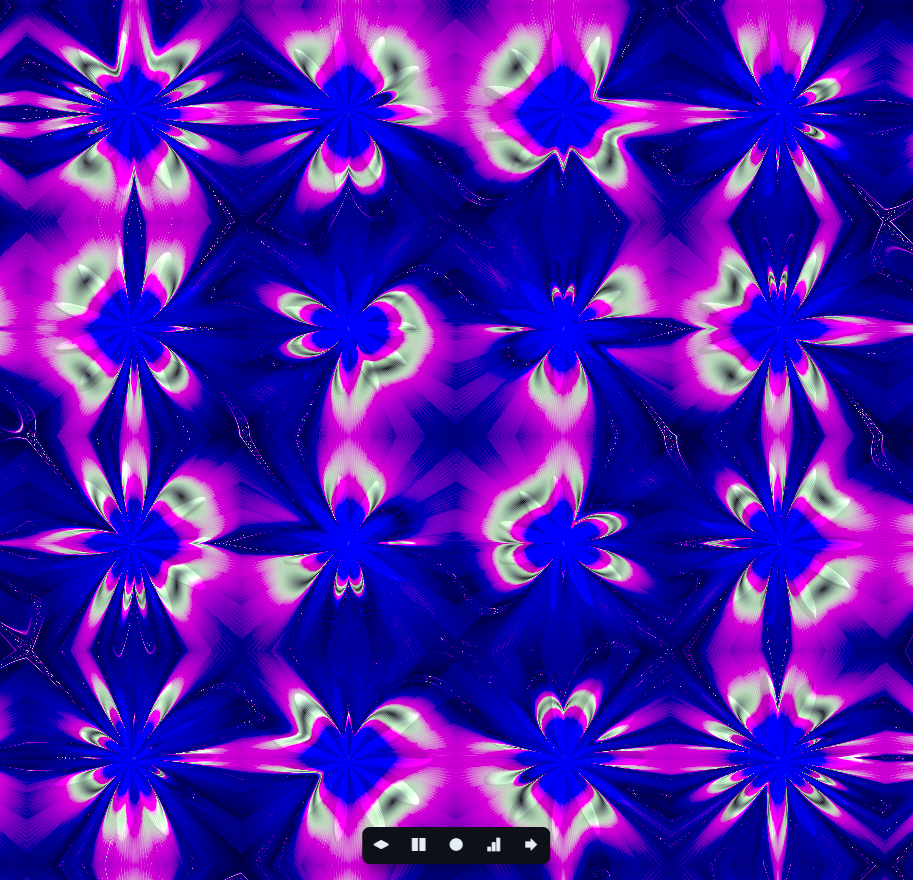
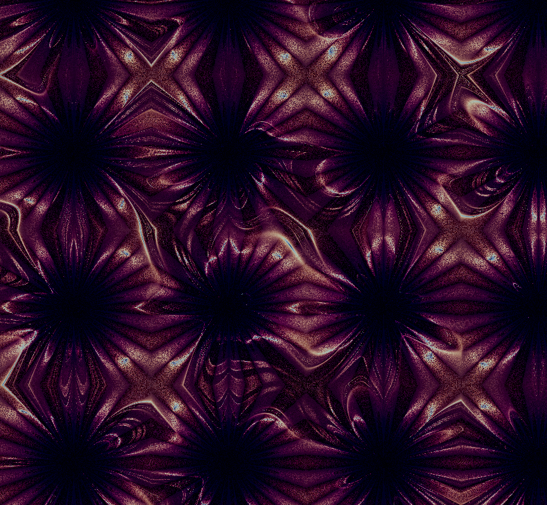
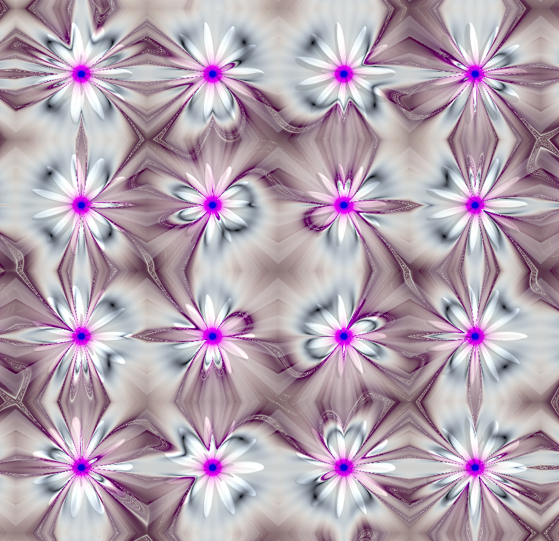

**Procedural Generation and Simulation**  

Maria Jende, 10/25/2026

 

# Final Project - *Liquid Sunflowers*

 

**Acess the results [here](https://owncloud.gwdg.de/index.php/s/j9cbGEnr6EoCQ6n).**

**Review the code [here](./code/pgs_ss26_05_jende.glsl).**

 

## Summary

Liquid Flowers is a GLSL shader that combines a grid pattern of animated 2D and 3D (ray-marched) flowers. A time-based distortion function animates the flowers and offset color values create a dreamy, meditative look. Users can adjust the tint and the balance between a noisy and a sleek look via the mouse position. A first audio-reactive test was done in TouchDesigner.

 

## Concept

I had already worked with the theme of seasons in my first-term project (winter) and in CC1 (spring), so I wanted to continue the series with summery visuals. This theme guided my visual decisions throughout the process. It also suited my intended way of working for this project by experimenting in and further learning GLSL, since it was visually open and not too restrictive. In addition, I wanted to further work on the flower shapes from the pattern I created in [session 02.02]((./code/pgs_ss26_02.02_jende.glsl)) and animate them.

 

## Implementation

I found several Shadertoy examples that inspired me and used them as starting points by wokring on understanding how they work and then experimented with them. I always worked in VS Code with glsl-canvas. The first shader I studied was [*Zippy Zaps [394 Chars]* by SnoopethDuckDuck](https://www.shadertoy.com/view/XXyGzh). I abstracted its ripple distortion code until I found visuals I liked, then implemented them into my flower pattern. Once the distortion was in place, I wanted the colors to shift along with the "waves" of the animation. I borrowed the offset color logic from this [*Creation by Silexars* by Danguafer](https://www.shadertoy.com/view/XsXXDn), which created nice color shifts. At this point the visuals were already pleasing, but I wanted to take them a visually step further by introducing 3D objects. For that, I used resources by [Inigo Quilez on Shadertoy](https://www.shadertoy.com/view/Mt3BDj) and [his website](https://iquilezles.org/articles/distfunctions/) and integrated his geometry extrusion and beveling approach into my code. I then fine-tuned the visuals in GLSL.  
I tested the version without the 3D flowers for audio-reactive animation in TouchDesigner, using the track *2000* by Mietze Conte. The low frequencies control the petal count and the high frequencies control the distortion effect.

 

|  |  |  |
| ----- | ----- |  ----- |
| Experimenting with [*Zippy Zaps [394 Chars]* by SnoopethDuckDuck](https://www.shadertoy.com/view/XXyGzh) | Final code Set-Up |  TouchDesigner audioreactive Set-Up |

 

## Results

**Acess the results [here](https://owncloud.gwdg.de/index.php/s/j9cbGEnr6EoCQ6n).**

**Review the code [here](./code/pgs_ss26_05_jende.glsl).**

 

 

 

 

## Project Reflection & Discussion

I really enjoyed this project and love the visuals, which makes it a success for me. I learned a lot about GLSL and how different it is from other languages. Starting with experiments on Shadertoy examples was a good approach, since it lowered the barrier to working with complex code, was fun and got me to pleasing visuals faster. For the next project, however, I want to design specific visuals first and plan the architecture myself beforehand.

I learned several new logics (e.g. offsetting RGB values for a color shift effect) and new functionalities (ray-marching), which will help me in future projects. Ray-marching turned out to be far more complicated as well as time-intensive than expected, and it did not deliver the upgraded look I was aiming for. It would not be part of the code without the help of AI. Still, I'm glad I explored it and want to understand and work with it further.

The TouchDesigner setup worked well, but I would like more variation over the runtime of the animation, perhaps by choosing less monotonous music or linking more parameters.

 

## Lessons Learned

I learned a lot, especially about how GLSL works and its general logic. I used functions much more than before, since my code grew long enough that it needed more structure. The other big new topic was ray-marching, which I still haven’t fully grasped and for which I needed AI help to tackle. I had also never worked in TouchDesigner before and was pleased by how quickly I got a good setup. It was still a new environment and I needed time to find my way around its functionality and UI.

 

## AI Notice 

I used Claude Sonnet 5.5 and Gemini 3 interchangeably to help me with the following tasks:

+ “Translating” code from Shadertoy to glsl-canvas in VS Code
+ Explaining code examples from Shadertoy
+ Restructuring code
+ Implementing the ray-marching
+ Debugging the ray-marching (e.g. aligning the center position of the 2D and 3D flowers by implementing focal length)
+ Polishing comments