**Procedural Generation and Simulation**  

## Final Project - 80 Points

---

# Into the Ice

  
   
  <em>Render with some issues...</em>

  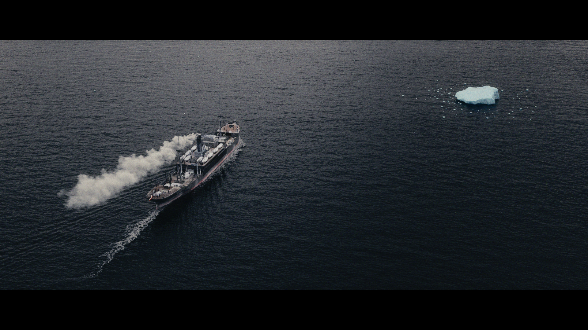
  &nbsp;
  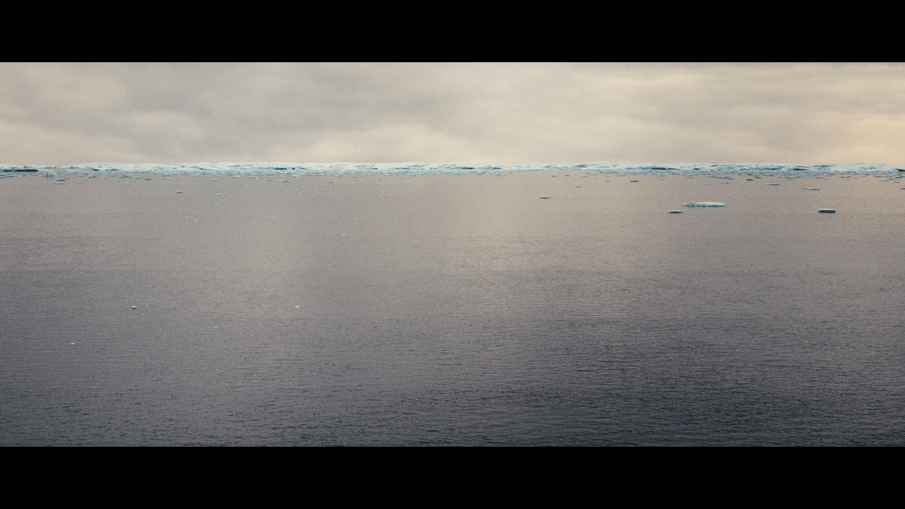
   
  <em>Test Frames</em>

**Project and source files:** https://owncloud.gwdg.de/index.php/s/QaaYR55q3PVAY4b

### Summary

A single fully CG shot made in Houdini 22: a bird's-eye view of the SMS Wolf, a German First World War auxiliary cruiser disguised as a cargo ship, moving through the ocean. The camera pans up to reveal an ice field, with drifting floes growing denser towards the horizon. My focus was on procedural setups: a layered ocean spectrum, a fully controllable ice scattering system, fake floating of the floes on the ocean surface, a pyro smoke simulation for the funnel and small walking characters on deck.

The shot comes from a personal project that I combined with this course.

### Concept

I wanted the empty, cold mood of a ship heading into polar water.

The project connects to two sessions of the course:

- **Algorithmic Setups (Session 03):** instead of placing ice by hand, the whole ice field is generated procedurally and controlled from a single controller.
- **Noise & Randomness (Session 04):** the ice distribution is driven by noise and density attributes, every floe gets a random rotation and scale, and everything is controlled by a seed. The ocean itself is built from layered spectra.

### Implementation

#### Ocean

I layered three different **Ocean Spectrum** nodes and merged them into one combined spectrum, previewed with **Ocean Evaluate** and rendered with the **Karma Ocean LOP**. I also shaded the water and the whitewater.

  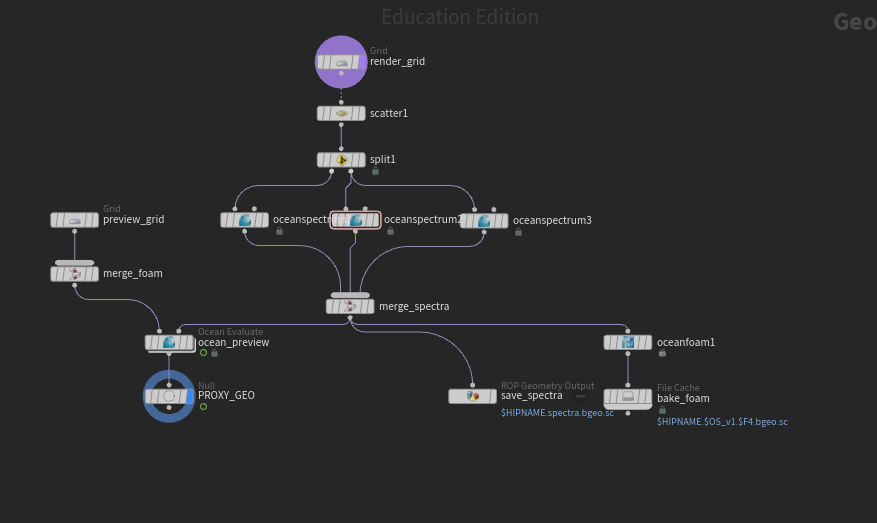
   
  <em>Layered ocean spectra network</em>

#### Ice scattering

The ice field is built from two parts:

- **Large icebergs**, each surrounded by smaller floes through a custom node setup.
- **Single floes** scattered across the whole surface.

I combined a random scatter driven by noise with a density-driven scatter, where the density is computed in an **Attribute Wrangle**. Every floe gets its own random rotation and scale.

All settings are collected as spare parameters on a single **Null** that acts as the controller. From there I can set the maximum floe size, swap in different ice models, change the seed and adjust the distribution without going into the network.

  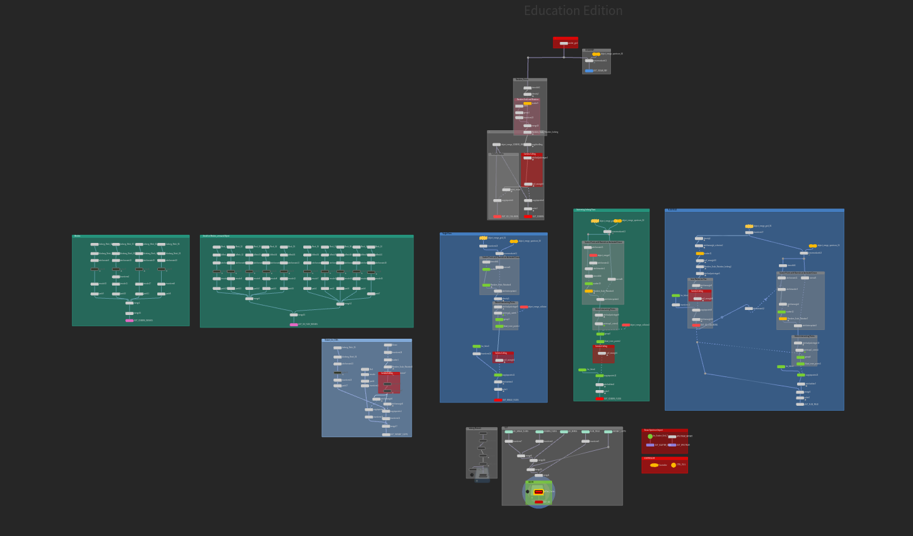
   
  <em>Ice scatter network</em>

  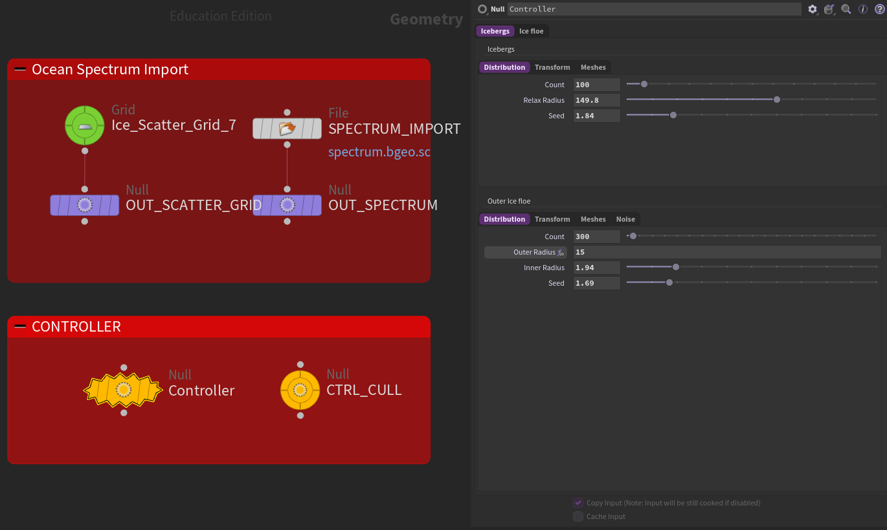
   
  <em>Ice controller parameters</em>

#### Fake floating

I wanted the smaller ice floes to move with the water, but simulating hundreds of floes would have been far too heavy, so I faked it: each floe is pinned to a spot on the animated ocean and rises, falls and tilts with the waves.

  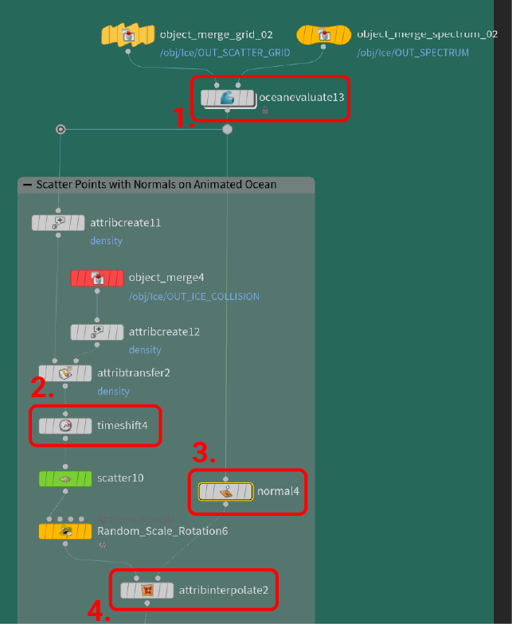
   
  <em>Fake floating setup</em>

1. **oceanevaluate13** creates the animated wave surface from the spectrum.
2. **timeshift4** freezes the surface on one frame so the scattered points don't pop.
3. **normal4** adds normals to the animated surface for the wave tilt.
4. **attribinterpolate2** snaps each point back to its spot on the animated surface every frame, carrying position and normal along.

#### Smoke

The funnel exhaust is a pyro smoke simulation.

  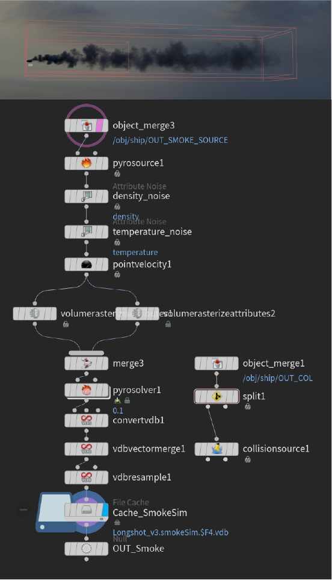
   
  <em>Pyro smoke setup</em>

#### Characters on deck

Since the characters are only seen from far away, I generated a character sheet with Gemini and turned it into a textured 3D model with Tripo AI. The character is rigged with the Mixamo skeleton and animated with Mixamo clips, some of which I blended together to get longer animations.

  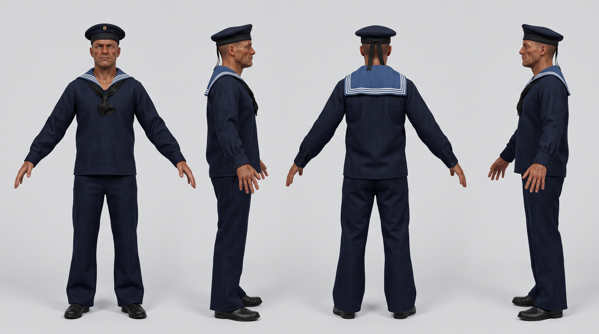
   
  <em>AI generated character sheet</em>

  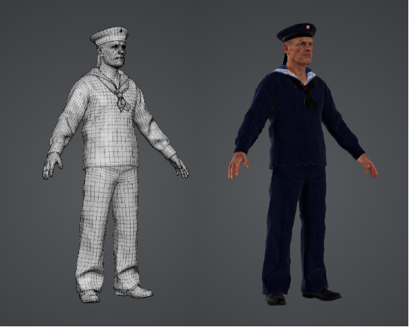
   
  <em>Character model from Tripo AI</em>

My first approach was a classic crowd simulation, but it did not work well in the very tight space of the deck, so I dropped it.
Instead, I placed points by hand where characters should walk and scattered additional points on the ship to spawn agents. The agents follow guide curves with **Crowd MotionPath Follow**, and **Crowd MotionPath Avoid** keeps them away from each other and from a rough collision mesh of the ship that I modeled in Blender. This turned out to be much more controllable than the simulation.

  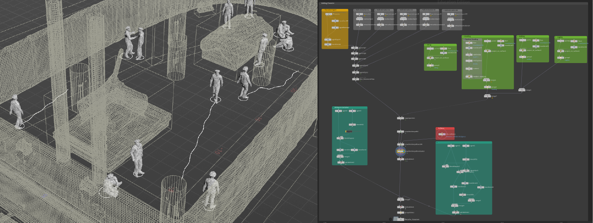
   
  <em>Crowd MotionPath setup</em>

#### Ship and rendering

The ship model was imported through USD, so all textures stayed connected. The shot is rendered in Solaris with **Karma XPU** at 1080p and is 177 frames long.

  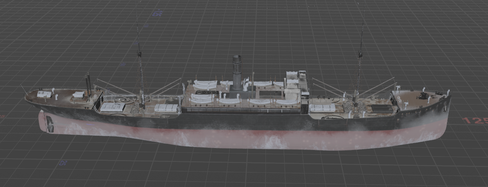
   
  <em>USD Ship</em>

### Results

The most obvious problem is the ice rendering, which still has some issues I need to figure out. I sadly did not have the time to fix them before this submission.
Several other parts also need improvement: the smoke needs to be much thinner and darker, the whitewater has to be re-simulated because it was built on an earlier version of the ocean spectrum, and the shot is not composited yet. I also plan to add clouds and light snowfall, probably in Nuke, reusing the particle setup from an earlier snowstorm shot.

### Project Reflection & Discussion

The project took far more than the planned 40 hours. Most of the extra time went into rendering: I started in Mantra because it was easier to understand, then switched to Solaris and Karma, which meant rebuilding most materials in MaterialX. The growing ice field also made the scene heavy and slowed down every iteration.

### Lessons Learned

- **Start in the final renderer.** Switching from Mantra to Karma late cost me a lot of time.
- **Plan render time from the beginning.** At almost an hour per frame in 4K, a 177-frame shot would take over a week on one computer, which is why I dropped to 1080p. With a commercial license I could have used a render farm.
- **Keep the scene light.** Distant parts like the horizon could be a matte painting instead of real geometry (I can't draw though..)
- **Check what the camera can see before building a setup.** The fake floating works, but from this distance the motion is barely visible, so I don't think it was worth it for the shot.
- **One controller saves time.** Having all ice settings on one node made it much faster to try variations.

### Credits

- Whitewater simulation: Fellow friend that doesn't want to be named (shading by me)
- Ship model and flag simulation: Kay Propheter, Maryna Komisarova
- Character model: character sheet generated with Gemini, 3D model generated with Tripo AI
- Animations: Mixamo

## Wrap-Up - 3 Points

### Task 05.02 - Feedback

Please answer the following questions briefly so that I can further improve the lecture for future students.

* How would you rate the difficulty of this lecture from 1 (far too easy) to 5 (far too difficult)?

3

* How would you rate the amount of work you had to put into this lecture so far from 1 (no work at all) to 5 (far too much work)?

It depends on the session, but overall a solid 4.

* How well did the given time estimates for each session match the time you needed to complete the session?

For the sessions the estimates matched well. For the final project they did not, but that was because I set my own scope too high.

* What do you think about Unreal as tool to learn for a CTecht & VFX student? Is it valuable?

Yes, Unreal is a great tool to learn. For my final project I still chose Houdini, because I wanted to challenge myself.

* What do you think about Unreal as a tool for this class? 

It is the right tool for this class. It is not too complicated to get into, but still produces great-looking visuals.

* Do you have any other ideas reading which tools and software packages to use for this class?

Blender Geometry Nodes and Houdini.

* Do you have any useful hints to pass on to future students, e.g. utility tools, or further resources?

Try out as many different things as you can and challenge yourself.

* What is your opinion regarding practical exercises in class? Did they fit? Did you enjoy working o

They fit well and I enjoyed working on them.

* How did the practical exercises fit the theoretical topics of the class? 

They fit the theory very well.

* Did you enjoy working on the practical exercises? If not, why not? 

Yes, I enjoyed them.

* Do you think the practical exercises where beneficial for your learning?

Yes, they taught me a lot of things I had not heard of before.

* Which one was your favorite chapter, and which one was your least favorite?

My favorite was Algorithmic Setups, especially the Fancy Cubes exercise. I do not really have a least favorite, since I found all chapters well taught.

* Was there a topic missing and if so which one?

Not really.

* Are there any other artists that would fit to the class content and that would be worthwhile to discuss in class?

None that come to mind.

* Please feel free to add any feedback you want to give!

No further feedback.

## Learnings - 10 Points

### Task 05.03.01

Summarize your learnings within the course in whole sentences. What was challenging for you during this course? How did you challenge yourself?

**Answer:** Most of the course assignments were done in Unreal. Since I already had experience with it, the workflow felt familiar, but I still challenged myself with systems that were new to me, such as the Motion Design tools. For the final project I went one step further and stepped out of my Unreal comfort zone into Houdini. The biggest adjustment was probably offline rendering: after working in real time, waiting for every render still bothers me. At the same time, I learned that you can get amazing results if you really invest the time. The most challenging part was working within technical limitations, especially on the university computers. Updating a single parameter often meant a long wait, and Houdini crashed quite frequently, which made iterating slow and frustrating.

### Task 05.03.02

To make the best possible use of the lecture, please reflect on the following questions.

Does it make sense for you

* ...to have procedural generation in your set of skills? If yes, 
    * with which tool do you want to work with?
    * which outputs / designs / setups are you aiming for?

    **Answer:** That's definitely a yes, because this project would not have been manageable without it: the ice field with its hundreds of floes only worked because it was generated procedurally instead of placed by hand.

    **Tool:** Houdini, since I built this whole project in it.

    **Aim:** Procedural environments and FX setups for film, like the ice field in this shot, turned into Houdini Digital Assets that I can reuse across projects.

* ...to have Unreal in your set of skills? If yes, 
    * which Unreal topic so you want to look into next?
    * which outputs / designs / setups are you aiming for?

    **Answer:** Yes, because real-time feedback would have helped with my biggest problem in this project: the heavy scene and long render times slowed down every iteration. However, in my opinion Unreal's current rendering pipeline is still a bottleneck when it comes to quality.

    **Next topic:** Unreal's PCG framework combined with Houdini, so I can bring my procedural Houdini setups into Unreal.

    **Aim:** Procedural environments built in Houdini that I can adjust and art direct in real time inside Unreal.

---
### AI Notice

- Gemini (Google) was used to generate the character sheet for the deck characters.
- Tripo AI was used to turn the character sheet into a 3D model and texture.
- AI assistance was used while developing the fake floating setup.
- Claude (Anthropic) helped structure and write this documentation.
- AI was used to check grammar.