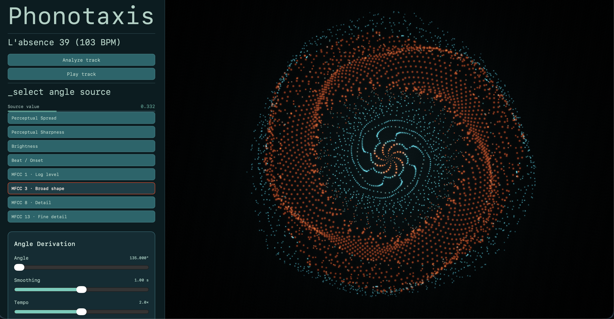
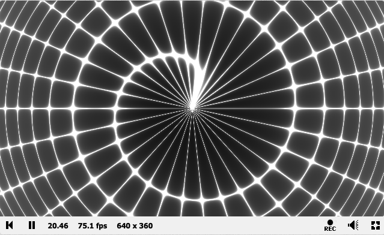
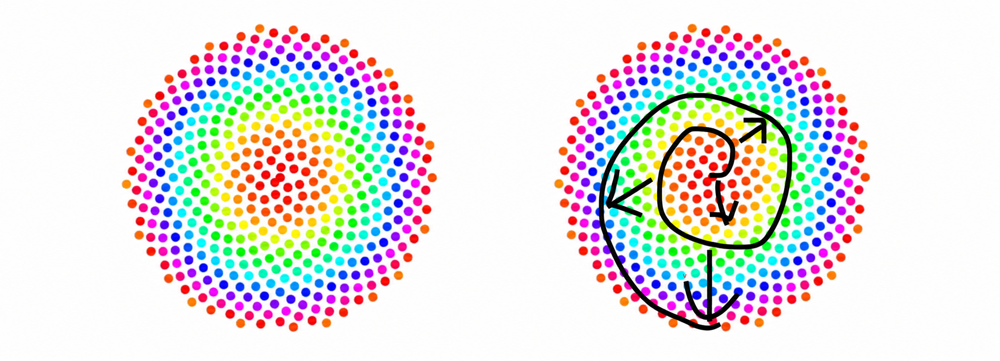
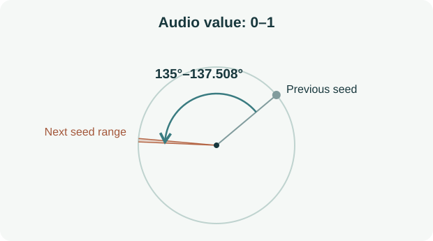
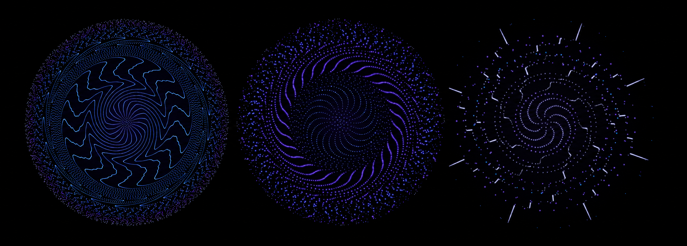
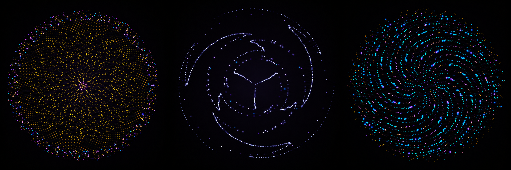
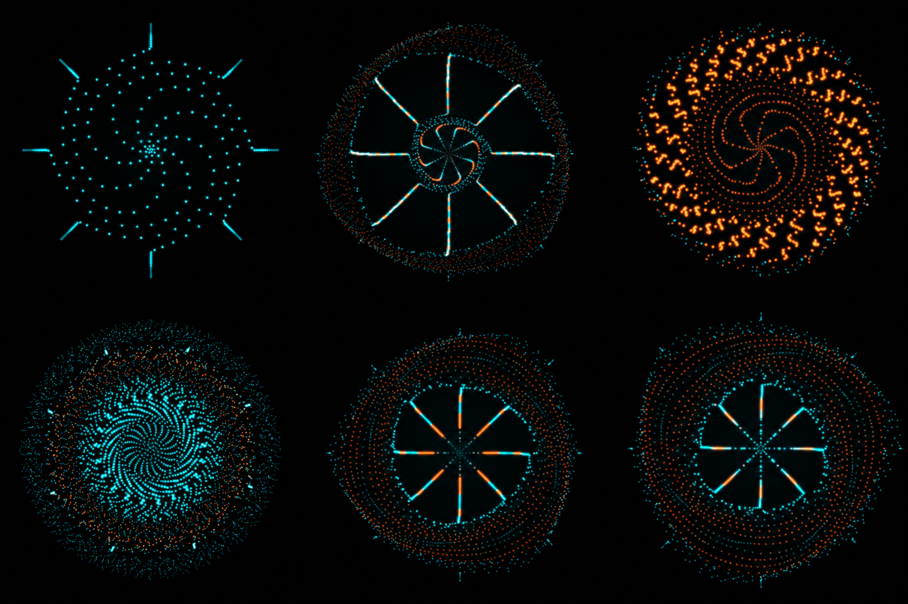

**Procedural Generation and Simulation**  


Prof. Dr. Lena Gieseke \| l.gieseke@filmuniversitaet.de  

---

- [Final Project - Phonotaxis](#final-project---phonotaxis)
- [Feedback](#feedback)
- [Learnings](#learnings)


# Final Project - Phonotaxis

## 1. Summary 🏵️ 
 


*Phonotaxis is a web-based shader system that turns audio tracks into an almost continuously growing flower. The project explores how sound-driven deviations from the golden angle shape visual patterns. Based on the principle of phyllotaxis and the golden angle, it uses timbre and other audio features to influence the growth and appearance of the seeds, creating a distinct visual fingerprint for each track.*

The system runs in a browser via a local server and uses HTML, CSS, JavaScript, and GLSL shaders. Users can upload audio files and select which audio feature controls the arrangement of the seeds. 

Happy exploring! :) 

**Link to website**: [Phonotaxis](https://kathapult.github.io/PGS_05_Phonotaxis/)

**Git Repo**: [Phonotaxis Files](https://github.com/kathapult/PGS_05_Phonotaxis.git)


---

## 2. Concept 🏵️ 

### Oh, nooo - phyllotaxis again! 🏵️

 Yes, I know - we've all seen these visuals and there might be not a lot new to see - but I am fascinated by the topic of phyllotaxis: a simple, well-known principle and I wanted to explore this visual on my own and experiment with sound influences on spirals. 


**Inspiration:** for submission 2, I chose this shader on Shadertoy as a visual reference: [spiderweb](https://www.shadertoy.com/view/fdt3zj). I was particularly drawn to its continuously growing spiral.




I returned to the p5 example from the course materials: a classic phyllotaxis simulation using dots. My idea was to combine these seeds with the spiderweb shader's implementation of continuous growth from the center (not moving outward).



*simple phyllotaxis flower is usually adding seeds from inside*

**Idea:** My idea was to combine those two, and to experiment with deviations from the golden angle in the phyllotaxis formula and explore how these affect the emerging patterns of a simulated bloom, e.g. when the angle is controlled by sound: *How can real-time parameters shape the visual apperance when darwing an evergrowing flower?*

This was an open-ended idea without a predefined visual outcome. As the project developed, I extended the idea to include further parameters and  modulations of the formular.

**Goals:**
My goals were to strenghten my understanding of shader programming by using GLSL, to start with an open process exploration of the mathematic principle of phyllotaxis, and implementing sound.


---

## 3. Implementation 🏵️ 

### Enviroment descision: Web + GLSL + Javascript 

For the reason that plain GLSL as a shader language can not process audio signals, working with Touchdesigner was an initial idea for implemetation, but I wanted my project to be run without pre-requisites. I decided to try a web envirmonent with an implemented shader, to keep it runnable on a local server.

**Meyda**
I researched about [Meyda](https://muwiserver.univie.ac.at/p5/meyda_features.htm), an Javascript library that allows to analyse sound in real-time. It offers extractions of e.g. loudness, brightness, or beat, Chroma values and timbre (MFCC 1-13). With the support of Claude I got these parameters extracted and then hand over into my shader files. 


**AI support:** I used GenAI (Claude Antophic + Codex) for implementing a basic file structure with OpenGL and to set up the audio file analysis, so that I can focus on the experimentation within the shader files without going over the given scope of time: `seed.vert`, `seed.frag` and `post.frag`. JavaScript does the audio extraction and creates each seed as a data record. The shaders calculate its position, size, orientation and appearance.


*project folder:*

```text
Phonotaxis/
├── index.html             HTML entry point and interface elements
├── style.css              Interface layout and styling
|
├── src/
│   ├── sketch.js          Application logic, audio analysis and controls
│   └── webgl.js           WebGL setup and rendering utilities
├── lib/
│   └── meyda.min.js       Local audio analysis library
|
├── shader/
│   ├── seed.vert          Seed vertex shader
│   ├── seed.frag          Seed fragment shader
│   └── post.frag          Post-processing fragment shader
```

---

### From audio to a visible seed 

**data flow:** 

JavaScript prepares the audio values and stores seed properties; the GPU calculates their positions and appearance.

```text
JAVASCRIPT                                      GPU / SHADERS

Upload audio file
        ↓
Audio decoding + Calibration of feature ranges
        ↓
Play track → Meyda → Sound Analysis `onAudioFrame()`
                    Smooth + normalize to 0–1
                              ↓
draw() — draws & updates every animation frame
        ↓
growSeeds() → addSeed()
Store sound values + birth time + angle
        ↓
renderScene()
        ├── updateSeedTexture()(Texels) ── upload ─→ Data texture
        │                                          ↓ fetchData()
        └── drawSeeds() ── drawing command ─────→ seed.vert — VERTEX
                                                  Read seed record
                                                  Position + size + orientation
                                                  6 vertices → 2 triangles
                                                         ↓
                                                 seed.frag — FRAGMENT
                                                  Color + round core + glow
                                                         ↓
                                                 Combined seed image
                                                         ↓
                                                 post.frag — POST-PROCESSING
                                                  Haze + tone mapping
                                                         ↓
                                                       Screen
```

- **Stored data:** each seed keeps its sound values, birth time and angle in a data texture.
- **Live uniforms:** `renderScene()` also passes time, resolution and changing audio / motion values to the shaders.
- **Rendering:** the drawing command starts shader execution. All existing seeds are redrawn each frame; only changed seed data needs uploading.


###  `sketch.js` controls, calibration and seed records

**1. Controls + audio preparation**

- **UI:** upload / play a track, choose an angle source, base angle
- **Calibration:** `calibrateTrack(file)` decodes the track; `analyzeTrackBuffer()` collects smoothed Meyda features and determines lower / upper limits using percentiles. These track-specific ranges make changes in loudness, brightness and timbre more noticeable after normalization to 0–1
- **Playback:** `startCalibratedTrack()` applies the ranges through `setAudioRanges()` and connects the decoded track to Meyda through `startAnalysis(source)`
- **Live analysis:** `onAudioFrame(features)` smooths and normalizes the measurements into `measured` / `normalizedAudioFeatures`, then updates the selected angle value and rhythm detection

**2. Seed creation + angle**



- `draw()` → `growSeeds()` → `addSeed()`: loudness controls when seeds are created; the selected feature controls the angular step.
- One seed record occupies **three texels × four numbers**; e.g. the first texel stores `[loudness, brightness, noise, birth time]`.

### `seed.vert` + `seed.frag` + `post.frag`: position + appearance of seeds

**1. Vertex shader — where is each seed? (`seed.vert`)**

Vogel's formula is split between JavaScript and GLSL: JavaScript accumulates the sound-dependent angle; the vertex shader combines it with a square-root radius.

The basic principle in pseudocode:

```text
angleRange = 137.508° - baseAngle
angleStep = baseAngle + controlValue * angleRange
angle = this seed's stored angular position
age = seedCount - 1 - n          // n = fixed birth index
radius = spacing * sqrt(age)
```

`controlValue` is the selected audio feature normalized to 0–1. The live view uses a fixed full canvas width with `FILL = 1` and `BUILDUP_SEEDS = 500`.

In the vertex shader, this becomes:

```glsl
float theta = TAU * seedTurns;
vec2 outward = vec2(cos(theta), sin(theta));
// ... spacing, age and animation factors ...
vec2 pos = spacing * sqrt(age) * travel * radialFactor * outward;
```

- `fetchData()`: reads the seed record
- `TAU`: converts stored angle from turns to radians
- `sqrt(age)`: sets the radius with outward motion
- `travel`: animates arrival
- `radialFactor` adds wave deformation / modulations
- Around the center `pos`, the shader scales and orients a square made of **two triangles / six vertex entries**. It runs once per entry; two corners are repeated where the triangles meet.

**2. Fragment shader — how does each seed look? (`seed.frag`)**

- Runs for fragments (triangles) + creates a round core and glow inside the square
- Stored **MFCC 2–5** → base color; **brightness** → light intensity; **selected angle-source value** → palette shift
- Stored source value also controls deformation strength in the vertex shader (slowly smoothed live value for wave motion control)

**3. Post-processing — how does the complete image look? (`post.frag`)**

- Processes the combined seed image with audio-reactive haze + tone mapping

---

## 4. Results 🏵️ 

*What patterns did I observe in my experiments?*

The implementation process involved a lot of trial and error, particularly with regard to how changing the angle through the sound parameters can actually produce noticeable differences. In the process, I tested many different ranges (i.e., the range in degrees that is variing). Interactive Online visualizations of phyllotaxis helped me with this, such as [Phyllotaxis simulator](https://www.mysimulator.uk/generative-art/phyllotaxis/).
 

**process images:**






Finally, the visual outcome strongly depends from the given audio track, the choosen angle source, smoothing factor (which was later added to archieve more stable pattern). The final assignments are:

### sound parameter → visual effect

| Parameter | Controls |
| --- | --- |
| Base angle  | Lower limit of the angular step; upper limit = golden angle (137.508°) |
| Selected angle source — stored at seed creation | Angular step, wave deformation strength, palette shift |
| Selected angle source — smoothed live value | Wave shape, frequency and animation speed |
| Loudness  | Seed creation rate, seed size, arrival speed; live deformation strength, haze intensity |
| Brightness | Seed light intensity |
| MFCC 2–5 | Base color |
| Noise (spectral flatness) | Irregular radial displacement |
| Beat / onset | Expanding light rings |


**final design:**



---

## 5. Project reflection & discussion 🏵️ 

My main aim was to explore the principle of phyllotaxis in the context of GLSL and to determine to what extent slight deviations in angle cause changes to an ever growing flower. Specific, if it is possible to create an individual fingerprint. My leading question was: *can a beat and rhythm subsequently draw a pattern in the blossom?* 
This was quite an interesting process and I spend a lot of time experimenting how the divergence range should best be set to produce noticeable changes and, ultimately, a pattern. To a certain extent, this seemed to work, and I achieved different results depending on the track. :)

However, the parameters and mapping are limited, so the result still seems a bit repetitive (at least from tracks from the same genre, e.g. electronic music). The sound analysis also required a lot of tweaking to archieve good results. Larger angular deviations, on the other hand, simply produced chaos and barely discernible patterns.
I caught myself getting a little too deeply immersed in these experiments, only to realize in the end that the final outcome is supposed to be a study in and of itself: Which parameters produce which results? Meaning, that I can only analyze it up to a certain point.

**AI reflection:** As already mentioned, I created the web environment (specifically the JavaScript files) and also shader code parts with the help of AI to realize my idea in the scope of the project. Therefore, these are not done fully by myself and I could not have achieved this on my own. At times, this made me feel a little lost in the process and somewhat unsatisfied, which is why I went through my files piece by piece again and again, giving me explanations of the code and specifically the data flow / communications with the shaders. Now I feel like it was an interesting project that helped me understand the connections from the UI all the way to the GPU. It strengthened my understanding of shaders, especially how the seeds are drawn from the sound triggers to finally get on the screen, the difference between vertex and fragment shaders, and the implementation into a web environment - but all in all, this idea blows up a bit the time scope of this submission.

***important note:** Some tracks produce patterns that are visually similar to the “Schwarze Sonne,” a symbol associated with right-wing Nazi ideology. Noticing this resemblance made me feel uncomfortable, because this was not my intention for the project - newerthenless I did not want to throw my idea away. These patterns emerge from the nature of phyllotaxis-based generative processes. I want to emphasize they are unintended and do not express an ideological statement.*

---

## 6. Lessons learned 🏵️ 

At the end of my process the main archievement for me is **understanding my rendering pipeline**, being able to reproduce how the positioning of vertices, the rasterizing of triangles, and colors are calculated. I got in touch with the **Connection between JavaScript and GLSL**. Throughout the code I understood how to **Transfer data to the GPU**, by storing seed properties in textures, the functionality of texels and passing those values through uniforms to access them in the shaders. 

With the help of Ai I explored **Analyzing and audio with Meyda** and to extract features such as RMS, brightness, spectral flatness and MFCCs; and **Preparing audio measurements** (calibrating, smoothing, normalizing).

Finally, regarding to my research question I explored the **principle of phyllotaxis**, working with the golden angle and square-root radius and observing how small angular changes affect patterns. Based on main priniple, I discovered how to **design procedural forms** by combining sine waves, triangle waves and smooth pseudorandom variation to add organic deformation of the blossom. All in all, this process was shaped by  **developing through experimentation**, by adjusting parameters and exploring the balance between order, variation and chaos.


My process contained out of five main parts:

1. creating web-enviroment: folder structure, html / CSS / JS *(AI supported)*
3. sound processing with Meyda *(AI supported)*
2. understanding of dataflow between web/js and shaders
4. experimenting with angle range / sound parameters / colors 
5. adding modulations / organic deformation

<br>

*And and most of all, this was fun!* 🏵️ 
 
---

<br>
<br>

# Feedback

Please answer the following questions briefly so that I can further improve the lecture for future students.

*How would you rate the difficulty of this lecture from 1 (far too easy) to 5 (far too difficult)?*

→ 3/5

*How would you rate the amount of work you had to put into this lecture so far from 1 (no work at all) to 5 (far too much work)?*

→ 3.5/5 - with good time management & activily avoiding to deep dive too deep into the topics!

*How well did the given time estimates for each session match the time you needed to complete the session?*

→ Usually I needed a bit longer (ca. 1-2 hours), but it strongly depended which topic, e.g. did not feel very comfortable with Unreal and needed more time getting familiar with it.

*What do you think about Unreal as tool to learn for a CTecht & VFX student? Is it valuable?*

→ In general I think it is a powerful program and it is nice to get the chance to explore it. On the other side it is so complex, that stepping in felt overwhelming and facing this threshold is especially valuable for people who like to continue working with it. For students, that like to work in 3D envirmonents and game dev contexts it is worth getting to know it, but for me, since I prefer working in 2D environments, I was torn between “it'd be cool to explore the potential and learn something new” and “I'd rather have used the time to practice GLSL, for example, since that is more likely to be my tool”.

*What do you think about Unreal as a tool for this class?*

→ Again, I think it is nice for students that really want to explore it, but I would have liked it if the choice of software had been more open — though I realize that would have made organizing the course more difficult. The high computational intensity and memory capacity also posed a challenge. I thought it was good that some assignments could also be submitted in GLSL and that the final project was completely up to us.

*Do you have any other ideas reading which tools and software packages to use for this class?*

→  Code baded: GLSL + Shadertoy, Touchdesigner

*Do you have any useful hints to pass on to future students, e.g. utility tools, or further resources?*

--

*What is your opinion regarding practical exercises in class? Did they fit? Did you enjoy working o*

→ yes.

*How did the practical exercises fit the theoretical topics of the class?* 

→ good. I especially liked the photo collections as an introduction to the topic at the beginning of class for a better understanding.


*Did you enjoy working on the practical exercises? If not, why not?* 

→ with Unreal Engine less e.g the cubes tutorial (because of the mentioned point), but in genreal yes. I like procedual generation :)

*Do you think the practical exercises where beneficial for your learning?*

→ yes. I still have to understand & practice a lot but it is a good foundation!

*Which one was your favorite chapter, and which one was your least favorite?*

→ fav: beauty in maths / patterns 
→ least fav: fancy cubes

*Was there a topic missing and if so which one?*
--

*Are there any other artists that would fit to the class content and that would be worthwhile to discuss in class?*
--

*Please feel free to add any feedback you want to give!*

→ Overall, the class was very inspiring and exciting and I really liked the nerdy deep dive into the visual maths! 
Two aspects I found challenging were that the lessons were often lecture-based and did little to encourage discussion, experimentation, or collaboration among us students. Additionally, I sometimes felt under pressure knowing that each person was expected to present their homework. I think it makes sense to complete and reflect on the homework assignments weekly, but this gave the course a somewhat school-like feel, which I personally found a bit stressful.
I see the topic of procedural generation as a area with a lot of potential for experimentation, but in this setting, I sometimes felt less comfortable sharing less polished work.


# Learnings

### Task 05.03.01

Summarize your learnings within the course in whole sentences. What was challenging for you during this course? How did you challenge yourself?

*Submission*: 

My most lasting lessons were about shader techniques and GLSL. I now have a better understanding of how processes work on the graphics card and where I can use shaders (more learnings in my final project). It was also particularly fascinating to see how mathematical principles can be visualized. After all I am quite happy, that I stepped into Unreal Engine once now and understood what blueprints are and how they work.


### Task 05.03.02

To make the best possible use of the lecture, please reflect on the following questions.

Does it make sense for you

* ...to have procedural generation in your set of skills? If yes, 

    * with which tool do you want to work with?
     GLSL + Local Servers, Touchdesigner, maybe Three.js

    * which outputs / designs / setups are you aiming for?
      setups: VJ setups, interactive sensorbased setups
      designs: flowy asthetics, audioreactive 

* ...to have Unreal in your set of skills? If yes, 
    * which Unreal topic so you want to look into next?
    -
    * which outputs / designs / setups are you aiming for?
    
Describe your next steps within the lecture topics depending on your answers.

Maybe designing a procedual VJ set with GLSL in Touchdesigner :)


