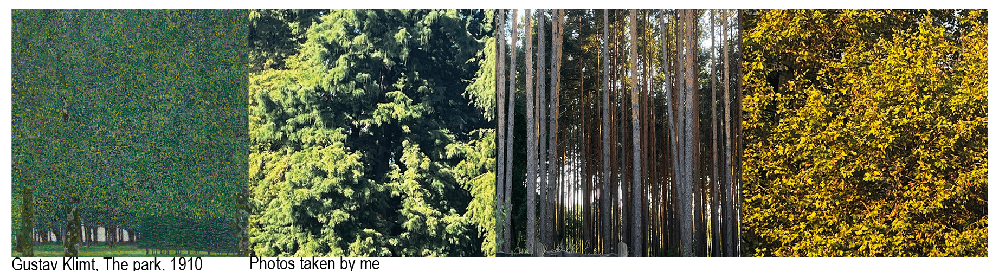
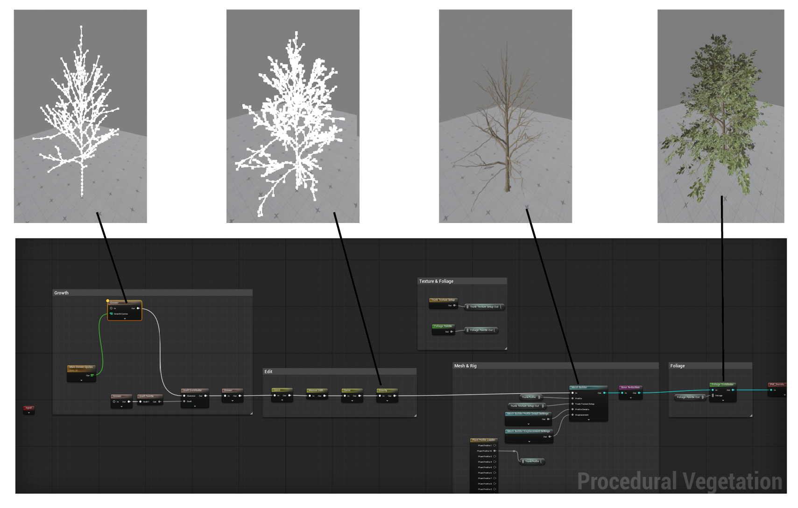
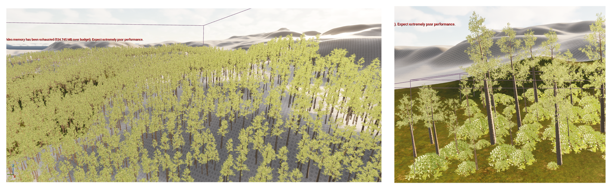
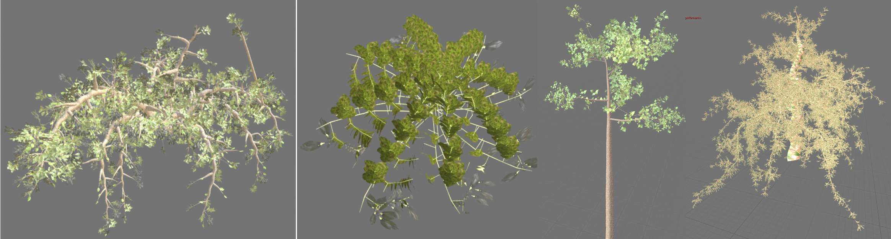
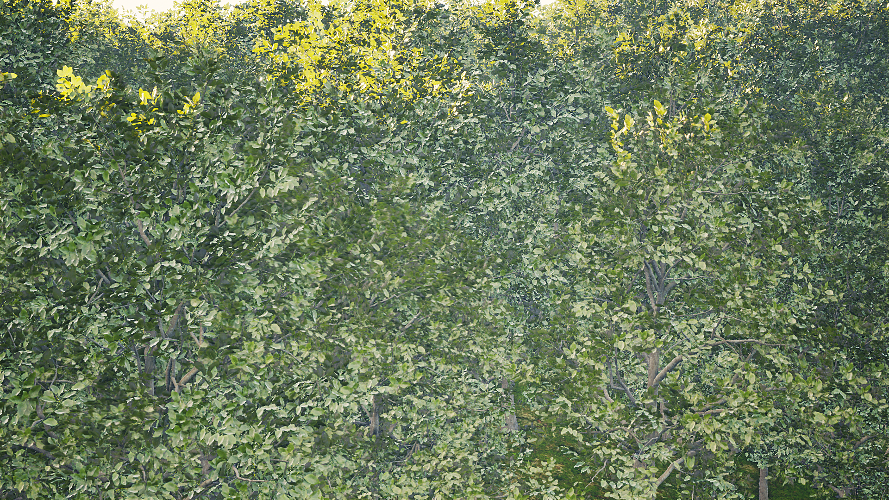

**Procedural Generation and Simulation**  

Prof. Dr. Lena Gieseke \| l.gieseke@filmuniversitaet.de  

---

# Session 05
26.10.2026, Nike Weber

## Final Project - 80 Points

  Here you can find a video of the results: https://owncloud.gwdg.de/index.php/s/2JDapCdBwvxMBvS

For the final submission I worked with the Unreal procedural vegetation editor and Unreal Procedural graphs.
The overall goal was to procedurally create trees / a forest in order to reduce the effort of modelling single trees and placing them individually.

#### Procedural Vegetation Editor
The PVE graph with different Zwischenstand images

#### PCG
procedurally placed trees and bushes

#### Tutorials I used for implementation

Procedural Vegetation:
 - "UE 5.8 - Procedural Vegetation (New System & Tools) - Tutorial"  - Unreal - X - Tutorials https://www.youtube.com/watch?v=umKOW2-WZoc
 - "Tutorial zum NEUEN Procedural Vegetation/Foliage Editor | Unreal Engine 5.7"  - Proj Prod https://www.youtube.com/watch?v=ohcCI_iScvA
 - "Creating Procedural Vegetation Is Easier Than Ever in UE5.8 | Procedural Vegetation Basics"  - Procedural Minds https://www.youtube.com/watch?v=5poZBLdlr1o&t=196s

PCG 
- "Unreal Engine 5.7 - PCG Vegatation - Build Your Own Forest - Tutorial (Part 2/2)" - Unreal - X - Tutorials https://youtu.be/4TZG9fBEiR0?si=0Ed1fqP79Jum7DHd

Basic Rendering tutorial:
- "Unreal Engine 5 Cinematic Camera Tutorial for Beginners STEP BY STEP" - EZ Unreal: https://www.youtube.com/watch?v=CW8hDvJOwGM&t=213s

#### Images
diferent types of trees I created with the PV editor

rendered image of a "wall" of leaves

#### Project Reflection & Discussion | Lessons Learned
Achieving my planned look was harder than expected, mostly steering the visual look in a direction that I want instead of just creating a pleasing image with randomized parameters. The performance issues that my laptop had slowed down this experimental process a lot which is why I couldn't implement all ideas I had planned (creating trees with a unique shape like a wheeping willow). Also I am not completely content with the lights and colors yet, since they look very generic. I got new skills in working with Unreal through discovering the new plugins, working with Instances, navigating in Blueprints and using the Movie Sequencer more than before.
What worked well concerning the process was planning low with the main goal to getting to know the procedural vegetation editor and creating different kind of trees. It seemed like not enough in the beginning but through trying out, failing at some points and the technical limitations it filled the requirements timewise.
What I would do differently doing this project again:
- think beforehand more specific about what I want to create, even if it is just "creating one specific plant"
- maybe resulting to VFX studio or ctech laptops to have a more productive working time and not be limited to the capacities of my laptop
- looking more strongly at naming convention and folder structure in Unreal, since it got a bit messy with time

What I plan for the future with my new set of skills:
- focussing on shading/materials/lighting and then rerender some scenes
- implement the scenes in one of my 2d-animations that yet has a very abstract representation of a forest
- trying out the "create tree from sample image" in order to create trees that go further away visually from the presets
- trying out abstract branch shapes and foliage
- getting to know "seasons" in Unreal Vegetation Editor

## Wrap-Up - 3 Points

### Task 05.02 - Feedback

Please answer the following questions briefly so that I can further improve the lecture for future students.

* How would you rate the difficulty of this lecture from 1 (far too easy) to 5 (far too difficult)?
 
3
* How would you rate the amount of work you had to put into this lecture so far from 1 (no work at all) to 5 (far too much work)? 
3
* How well did the given time estimates for each session match the time you needed to complete the session? 
it depended on the exercice but in total the time was estimated well. I felt like the "minimum" was always manageable but easy scalable if you wanted to learn more.
* What do you think about Unreal as tool to learn for a CTecht & VFX student? Is it valuable?  
Personally I found Unreal very valuable, especially with the use of procedural systems. The possibility to create realistic worlds is a skill that I have not had so far and that I imagine using in future projects. Also, Blueprints are very useful to understand code: doing the 10 line code in cc1 in P5js and in Pgs with Blueprint showed me that using blueprints make code more structured and easier understandable for me.
* What do you think about Unreal as a tool for this class?  
Since it takes some knowledge on the setup, functions and rendering in Unreal to produce goodlooking results and work efficiently, I find it hard to include Unreal in a class with students that not all have prior experience. I've noticed that the unexperience held me back from creatively going where I wanted.
That's why I found the session about GLSL better fitted for this course since it seemed easier accessible.
* Do you have any other ideas reading which tools and software packages to use for this class?
* Do you have any useful hints to pass on to future students, e.g. utility tools, or further resources?  
- Unreal Documentation is very useful and offers very in depth tutorials on plugins.

* What is your opinion regarding practical exercises in class? Did they fit?
- yes, it was a good contradiction to the theorethic and art historic parts of the lecture.
* How did the practical exercises fit the theoretical topics of the class? 
* Did you enjoy working on the practical exercises? If not, why not?  * Do you think the practical exercises where beneficial for your learning?

I mostly enjoyed it because the base that we had to achieve was simple but always had room to do more. Also I liked the creative freedom in this classes practical exercices. The order to start in class and then do something that goes deeper outside class worked well for me.
* Which one was your favorite chapter, and which one was your least favorite?
favorite was the lessons on GLSL and creating pattern.
Least one the particles in Unreal.
Other feedback: 
I really enjoyed the introduction to the course, with the first exercice being recognizing patterns in real life, creating one by hand, also the introduction through art history. I also appreciated that we could freely decide on whether to create abstract or figurative results.

## Learnings - 10 Points

### Task 05.03.01

Summarize your learnings within the course in whole sentences. What was challenging for you during this course? How did you challenge yourself?

The biggest challenge always sat after the first moment when I could navigate a system and very easily create a visual pleasing output (like a pattern in GLSL).
After that I struggled with shaping the outcome with my ideas rather than just random generated outcomes. Coming hand in hand with that choosing an idea and implementing it instead of trying out for a long time.

### Task 05.03.02

To make the best possible use of the lecture, please reflect on the following questions.

Does it make sense for you

* ...to have procedural generation in your set of skills? If yes, 
    * with which tool do you want to work with?
Yes ! Procedural generation is a real asset in my set of skills, for example for audio visualization. Even though Unreal was unpleaseant to work in case of performance issues, I found it really impressive especially for creating "realistic" images. So I plan on working more in it. 
    * which Unreal topic so you want to look into next? 
    
  handdrawn look in shading, camera animation, rendering settings, landscape editing
